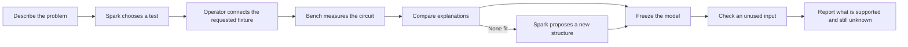
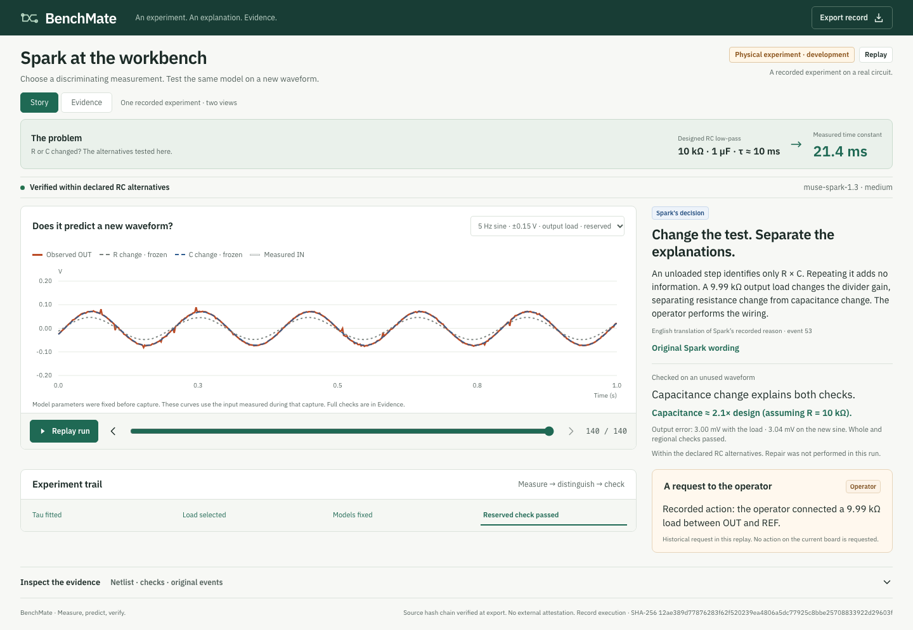

# BenchMate

**Muse Spark chooses an experiment, then checks its explanation against a real circuit.**

For students and makers who can see a circuit behaving strangely but do not know
what to measure next. Built solo during the Meta Global AI Developer Hackathon.



**Start with the real D01 experiment:** a designed 10 kΩ / 1 µF circuit responded
with a **21.4 ms** time constant instead of about 10 ms. Spark requested a known
output load to distinguish resistance change from capacitance change, then chose
a new sine-wave check. The unchanged C-change model passed both checks at
**3.00 / 3.04 mV RMS**; the R-change and nominal alternatives failed the common
whole-waveform/regional criteria. This supports a capacitance estimate of about
2.1× design **assuming nominal resistance**, within these declared RC alternatives.

[Real run, Spark’s decisions and raw evidence](examples/hardware-spark-rc/2026-10-30/20261029T174402-d3eaa8e612/README.md)
· [Open the Story replay locally](docs/physical-demo.md)



*Real hardware, recorded execution. These comparison curves use measured IN;
they are not output curves predicted before measurement. Spark chooses the test;
the operator changes the wiring. This run did not perform a repair.*

## What works today

| Capability | Evidence and status |
| --- | --- |
| Spark directs a physical RC diagnosis and checks an unused waveform | **Real hardware completed.** One bounded development run; repeatability is not yet established. |
| Spark proposes a structure outside five initial linear families | **Mock bench completed.** Proposed R + OUT→REF diode; two new input conditions passed. [All seven requests, prior prediction publication and checks](examples/b5-unloaded-spark/2026-10-30/20261030T133514-4ea9a8848e/README.md). Physical B5 remains pending. |
| Physical repair response | **Scripted engineering check completed.** [Recorded failures and subsequent incremental checks](examples/hardware-d01-repair/2026-10-30/README.md). Spark-directed physical repair remains pending. |
| Check a known design from an image | **Image → review → separate D01 replay implemented.** Local metadata removal, bounded Spark vision transport, editable candidate and explicit operator review. **Three synthetic schematic checks completed**: two label/connection matches, one unknown value preserved. Real photos and precise localization remain unvalidated. [All outputs](examples/vision-spark/2026-10-31/20261031T060049-13a656638d/README.md). [Scope and usage](docs/known-design.md). |
| No-tool comparison | **Five actual Spark replies retained.** Qualitative illustration, not a controlled accuracy benchmark. [All five answers and limitations](examples/no-tool-spark/2026-10-30/20261030T134112-a9742f1b2e/README.md). |
| General diagnosis, calibrated absolute voltage, sealed holdout and reliability benchmark | **Not established.** |

## Where Meta models make decisions

| Model | Actual role | Status |
| --- | --- | --- |
| Muse Spark 1.3 · medium | Selects physical D01 measurements, requests manual intervention, chooses verification and reports the result | Five recorded API requests |
| Muse Spark 1.3 · max | Selects B5 mock experiments and proposes the literal netlist; five separate no-tool responses | Seven mock-run requests + five baseline requests |
| Muse Spark 1.3 · vision | Reads a circuit image into a provisional design candidate | Three actual requests on synthetic schematics; real-photo evaluation pending |
| Muse Spark Open · Baseten | Connectivity experiment | No benchmark or physical-control claim |
| SAM 3.1 | Potential component highlight for a repair image | Documentation feasibility check only; not integrated or evaluated |

The numerical engine fits and scores models. Spark selects actions and authors
new structures; its prose is not itself experimental evidence. A photo of an
assembled circuit is kept separate from nominal design and from blind tests.

## Reproduce without hardware or API calls

Python 3.11+, `uv`, and ngspice 47+ for nonlinear work. See the
[full setup and evidence history](docs/evidence-index.md) for the pinned ngspice build.

```sh
uv sync --extra dev
uv run pytest -q
uv run benchmate view examples/hardware-spark-rc/2026-10-30/20261029T174402-d3eaa8e612/execution --output runs/demo/physical-d01.html
uv run benchmate simulate --case d01-c --mode repair
```

Open `runs/demo/physical-d01.html`: **Story** explains the problem, Spark's reason,
the operator request and the result; **Evidence** preserves the full checks and
original report. Replay requires no network or board.

For image intake, `uv sync --extra vision` then
`uv run python scripts/known_design.py serve --demo` starts a local **API-disabled** walkthrough.
Load the recorded schematic read, review it, and continue to the separate D01
physical replay with the same nominal design. This does not measure the selected image.
Paid execution is explicit, bounded and never activates hardware.

[Build your own](docs/build-your-own.md): parts and historical budget, complete
fixture wiring, firmware upload and the first communication check. New-builder
commissioning is still manual and has not been independently reproduced.

Physical work follows [the B5 operator guide](docs/b5-operator.md), a frozen
protocol and fresh operator confirmation. Do not infer the current wiring from
historical replay footage.

## Evidence, limits and provenance

- Predictions/model parameters are frozen before the designated verification
  observations. Command-input forecasts and measured-IN comparisons are labelled separately.
- Failed attempts and all selected comparison responses are retained. Development
  repeats are not a frozen success-rate benchmark.
- JSONL hash chains detect record changes relative to the saved hashes; they are
  not independent external attestation.
- Calibration is provisional, supported circuits are narrow, and manual fixture
  changes remain necessary. No general-purpose autonomous repair claim is made.

[Full evidence index](docs/evidence-index.md) · [Protocol commitments](docs/preregistration.md)
· [Physical experiment scope](docs/physical-agent.md) · [Source license](LICENSE)

Built during the event with Codex assistance. Muse Spark is the recorded runtime
agent. Core dependencies include NumPy, SciPy, HTTPX, pySerial, ngspice and the
Arduino UNO R4 toolchain. Optional vision preprocessing uses Pillow. UI fonts are
IBM Plex Sans under the included OFL license; prior design guidance is credited in
[the implementation history](docs/evidence-index.md).
