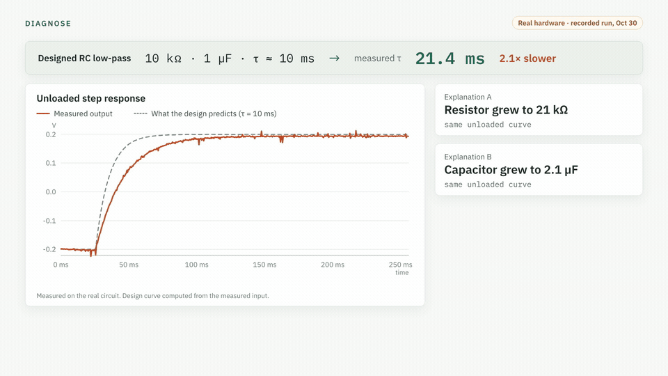
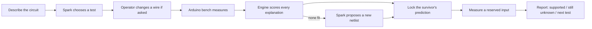

# BenchMate

**Muse Spark chooses the experiment. A $40 Arduino bench decides whether its explanation holds.**

On the Arduino forum, a voltage divider connected to an ESP32 read 1.1 V instead of 1.8 V.
Replies guessed resistor tolerance, the meter, bad solder. The right explanation (the
ESP32 had no power, so its input clamp loaded the divider) came early, but it took the
poster's own test to confirm it: *"Real life testing was the correct way to find the issue."*
([thread](https://forum.arduino.cc/t/voltage-divider-is-not-giving-correct-voltage/884099),
[confirmation](https://forum.arduino.cc/t/voltage-divider-is-not-giving-correct-voltage/884099?page=3))

BenchMate gives Muse Spark a bench to run those tests. For electronics students and makers
with no oscilloscope, no function generator and nobody to ask, it turns an Arduino UNO R4
into a signal source and recorder, lets Spark choose the experiments, and makes every
explanation earn its place with a measurement it has not seen yet.

**[Open the interactive replay](https://bami-codes.github.io/BenchMate/) · [Watch the 51-second physical diagnosis](https://bami-codes.github.io/BenchMate/#watch) · No installation or API key.**

Built solo during the Meta Global AI Developer Hackathon (first commit Oct 27, 2026).

[](https://bami-codes.github.io/BenchMate/#watch)

*Animation of one retained physical run, not live footage. [Static Story view](docs/assets/d01-story.png).*

## What it did on a real circuit

A low-pass circuit designed for τ ≈ 10 ms (10 kΩ, 1 µF) had a fault I planted in it.
Its measured time constant was **21.4 ms**. One trace cannot tell a larger
resistor from a larger capacitor: both give the same curve.

1. **Spark chose a test that separates them.** It reasoned that repeating the step
   adds no information, and asked the operator to connect a known 9.99 kΩ output load.
2. **Both explanations were locked before the loaded measurement.** "R changed" missed
   by **32.5 mV RMS**; "C changed" matched at **3.0 mV**.
3. **Spark tested the survivor on a reserved waveform** (5 Hz sine, never used for
   fitting): **3.04 mV**, inside the 9 mV whole-and-every-region allowance.
4. **Verdict:** capacitance ≈ **2.1× design** (assuming R = 10 kΩ). It also reported
   what it still did not know: exact component values and calibrated confidence.

The whole run took **5 min 49 s**: five Spark decisions, one wiring change by a human,
7,680 recorded frames. [Run report, Spark's decisions and raw events](examples/hardware-spark-rc/2026-10-30/20261029T174402-d3eaa8e612/README.md)

*Repair (restore the design, with the forecast pushed to GitHub before the operator
touches the circuit) has a working runner and a full mock rehearsal. [A real Spark-controlled mock rehearsal](examples/overnight/2026-11-02/README.md) has now completed; physical repair remains pending. No mock result is counted as a physical repair.*

## When no starting model fits, Spark writes a new one

The test circuit is a simplified input clamp inspired by the forum problem: a series
resistor and a hidden diode, not an ESP32. Spark is not told the wiring. On a simulated
bench (a mock of that circuit; Spark's decisions are real API calls), all five starting linear models failed (worst training error 86–131 mV, allowance 9 mV). Spark ran an
amplitude sweep, noticed the top half of the waveform flattening near +0.47 V, and
proposed a structure outside the five starting models: **a series resistor and a diode from OUT to REF.**
Its netlist went straight into ngspice, the fitted prediction was
[pushed to GitHub](https://github.com/bami-codes/BenchMate/blob/9cff3e8c3209c68bf489b5e3b2f95e0f27a8b74c/examples/b5-unloaded-freezes/20261030T133514-4ea9a8848e/predictions.json)
before two unseen inputs were measured, and both matched (**1.7 mV** RMS each) while
every linear alternative failed. [All seven Spark requests and checks](examples/b5-unloaded-spark/2026-10-30/20261030T133514-4ea9a8848e/README.md)

The same session runs against the physical fixture; the physical diode run is
scheduled after the repair.

## How it works



| Who | Does what |
| --- | --- |
| **Muse Spark 1.3** | Chooses each measurement, asks for wiring changes, proposes new circuit structures as netlists, requests a repair, writes the report |
| **BenchMate engine** | Simulates (state-space RC, ngspice for nonlinear netlists), fits training data only, scores whole waveform and every region, freezes and publishes predictions |
| **Arduino UNO R4 + LM358 buffers** | Drives the circuit (DAC), records IN/OUT/REF (14-bit ADC), rejects runs across reboots |
| **You** | Move a wire when Spark asks, confirm it, plug the USB back in |

## How Meta models are used

| Model | Role | Evidence |
| --- | --- | --- |
| Muse Spark 1.3 · medium | Runs the physical diagnosis: picks measurements, requests the load, asks for the reserved check | [Physical D01 run](examples/hardware-spark-rc/2026-10-30/20261029T174402-d3eaa8e612/README.md) |
| Muse Spark 1.3 · max | Discovers structure outside the starting models and writes the literal netlist | [B5 run](examples/b5-unloaded-spark/2026-10-30/20261030T133514-4ea9a8848e/README.md) |
| Muse Spark 1.3 · vision | Reads a schematic image into an editable design candidate the user confirms | [Known-design intake](docs/known-design.md) |
| Muse Spark Open · Baseten | Runs the same synthetic Task A through the bench; all first attempts retained | [30-case result](examples/overnight/2026-11-02/spark-open/README.md) |
| SAM 3.1 | Optional highlight of a component in a bench photo; one of three preregistered prompts segmented the capacitor body | [SAM probe](examples/sam-concept-probe/2026-11-01/20261101T063214-e48c4496e7/README.md) |

Two measured findings about Spark from this project:

- **A measurement-error hypothesis needed testing.** Asked the D01 question with no tools,
  all five replies opened with "nothing is wrong with the circuit", blamed the
  measurement and advised re-measuring. That is a plausible hypothesis; the bench showed
  the capacitor had changed. This is a qualitative case with different information access, not a 5/5 error-rate benchmark. [All five replies](examples/no-tool-spark/2026-10-30/20261030T134112-a9742f1b2e/README.md)
- **Both efforts selected the load in this recorded decision.** At the D01 load decision, medium
  and max both chose the load 5/5; medium answered in 4.5 s vs 14.3 s.
  [Ten-call comparison](examples/effort-comparison/2026-10-31/20261031T113227-558da839f7/README.md)

## Registered evaluation, including what did not improve

**What measurement access adds:** on 30 preregistered synthetic cases, Spark with the
bench identified all **24/24 in-family cases**; without measurements it identified
**8/24** and left 22 of the full 30 cases unresolved. The latter is appropriate
uncertainty, not 22 wrong answers. Engine and fixed-plan baselines also reached 24/24.
When both R and C changed, Spark submitted 5/6 justified rejection reports (one
incomplete), versus 6/6 for both deterministic baselines.
[Task A: every response and the different information conditions](examples/overnight/2026-11-02/task-a/README.md).

Spark Open also ran all 30 cases through the same bench: **21/24** in-family,
**1/6** completed out-of-family rejections, **8 incomplete**, no wrong IDs.
All eight failures returned multiple tools to an adapter requiring one per turn.
This is system performance including a transport mismatch, not a clean ranking of
model reasoning. The first results stay unchanged; any connection fix is a separate
development check. [Spark Open records and limitations](examples/overnight/2026-11-02/spark-open/README.md).

On 16 synthetic circuit-identification cases, Spark with the engine ranking hidden
finished **15/16**, versus **16/16** for the engine and fixed expert plan. Random
selection completed 30/48 repeated runs. No executed arm made a wrong identification.
Spark used 2.88 simulated mountings on average versus 1.00 for the fixed plan; this
supports keeping engine ranking in the linear workflow, not claiming LLM superiority.
One Spark run verified the model but exhausted its call budget before its final report.
[All first attempts, costs and comparisons](examples/overnight/2026-11-02/README.md).

Actual Spark also completed the mock repair workflow, and five preregistered repeats
of the same B5 mock each passed their held-out checks. These are software rehearsals;
physical repair, physical B5 and another operator's completion remain the next tests.

## Why you can trust the numbers

- **Predict first, measure second.** Model parameters are frozen before each scored
  measurement. Physical repair requires the forecast to be committed and pushed to
  GitHub before the operator acts; the run refuses the repair request if publication
  fails. The B5 mock above also published first. Some mock rehearsals freeze locally
  only, and their records and replays explicitly say so.
- **Every attempt is kept.** Failed forecasts, aborted runs and USB dropouts stay in
  `examples/` next to the successes ([first repair forecasts that missed](examples/hardware-d01-repair/2026-10-30/README.md)).
- **Tamper-evident records.** Each run is a hash-chained JSONL log; the viewer refuses
  a record whose chain or sidecar does not match.
- **Spark never sees the answer.** Assembly details, hole positions and earlier
  specimen results are withheld from model input.

## Try it without hardware

Python 3.11+ and [`uv`](https://docs.astral.sh/uv/). ngspice 47+ for nonlinear work
([pinned build](docs/evidence-index.md)).

```sh
uv sync --extra dev
uv run pytest -q
uv run benchmate view examples/hardware-spark-rc/2026-10-30/20261029T174402-d3eaa8e612/execution --output runs/demo/physical-d01.html
uv run benchmate view examples/d01-repair-rehearsal/2026-11-01/final_success/20261101T003829-400778438d --output runs/demo/repair-rehearsal.html
```

Open the HTML files: **Story** walks through the problem, Spark's reason, the operator
request and the result; **Evidence** shows every check and the original report.
No network or board is needed. `uv run benchmate watch <run-dir>` shows a run live.

For schematic intake: `uv sync --extra vision`, then
`uv run python scripts/known_design.py serve --demo` (API disabled by default).

[Build your own bench](docs/build-your-own.md): parts (about ₩56,000 / $40 including
spares), wiring, firmware and the first communication check.

## Limits

- Supported circuits are small passive RC fixtures plus a diode case; 0–5 V, low frequency.
- Calibration is provisional. Results are incremental-response checks against a 9 mV
  engineering allowance, not calibrated absolute voltages or confidence intervals.
- These are development runs on known fixtures, not a blinded accuracy benchmark.
  Repeatability across sessions and builders is not yet established.
- The operator still changes wires by hand; Spark only requests changes.
- The diode discovery result above is from a simulated bench until the physical run completes.

Final evaluation scope: [included and deliberately excluded work](docs/final-evaluation-scope.md).

Full history: [evidence index](docs/evidence-index.md) · [protocol commitments](docs/preregistration.md)
· [physical experiment scope](docs/physical-agent.md)

## Built during the hackathon

The BenchMate firmware, engine, agent workflow, viewers and experiment records were
built during the event, starting Oct 27, 2026 (see the commit history). Third-party
dependencies and the bundled font retain their own credits and licenses. Development
used Codex and Claude as coding assistants;
Muse Spark is the runtime agent. Core dependencies: NumPy, SciPy, HTTPX, pySerial,
ngspice, Arduino UNO R4 toolchain; Pillow for optional vision preprocessing. UI font:
IBM Plex Sans (OFL, included). [MIT license](LICENSE).
