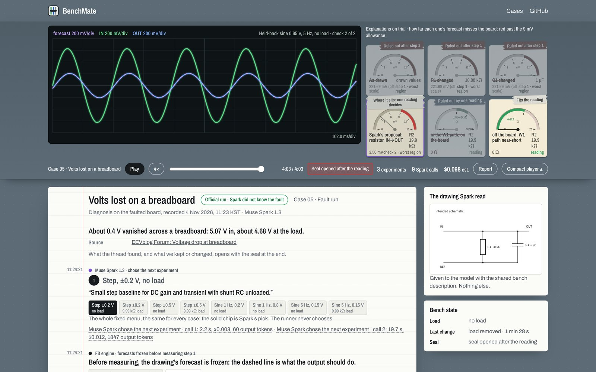
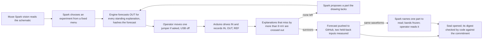
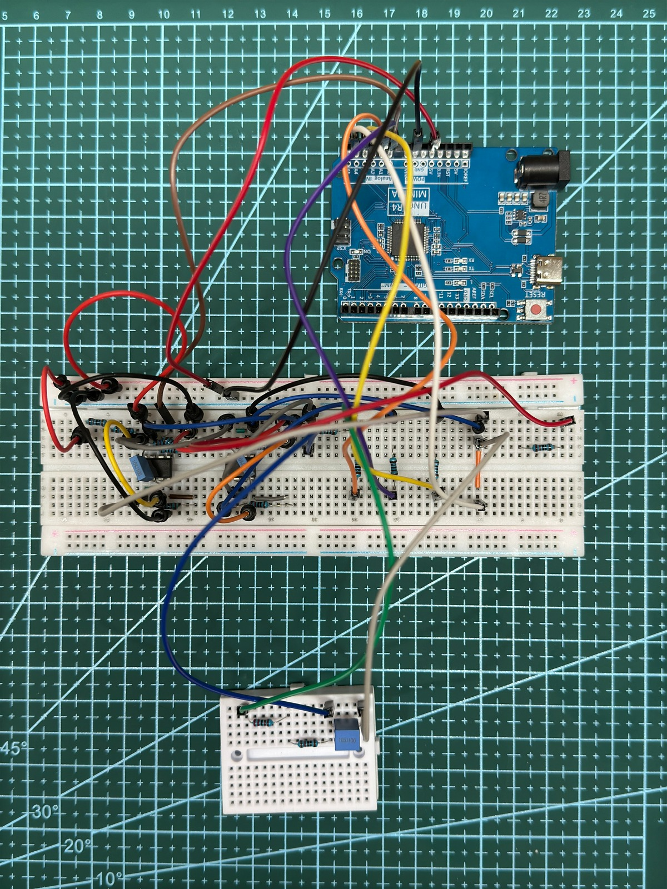

# BenchMate — forecast-first experiments on a real circuit

**The drawing is right. The board looks right. The output is wrong.**

That is the first power-on of a new board, when the output is not what the drawing says. The question at the bench is what to measure next, and which part to check. BenchMate gives that question to Meta's Muse Spark on a real board. It reads the schematic and chooses its own experiments; every forecast is frozen before the measurement and checked against it by code; the planted fault stays sealed until the verdict. Five faults were planted on five small circuits; the model narrowed each disagreement between board and drawing to one question, asking for one multimeter reading where the waveforms could not decide, and every step is a record you can verify offline.

**[Open the live demo](https://bami-codes.github.io/BenchMate/)** · **[Watch Case 04 from the start](https://bami-codes.github.io/BenchMate/run.html?run=20261103T150223-18d6f08ac9&play=1)** · **[The five cases](https://bami-codes.github.io/BenchMate/#cases)** · [Verify a record offline](#why-you-can-trust-the-numbers) · the film link will be added when it is uploaded.

Two results to remember. Case 04: the fault was not a component value; a diode the drawing does not show was needed, and Spark wrote it. Case 01: R1 was fine, and the extra resistance had to be found before it.

[](https://bami-codes.github.io/BenchMate/)

The experiments on that page did not exist until the model asked for them. That is the capability this project shows; a circuit on a $40 bench is the smallest honest place to show it.

Where the model contributed, from the records:

| Case | When the waveforms ran out | What Spark did | How it was checked | What the seal held |
|---|---|---|---|---|
| **04** [Divider reads wrong](https://bami-codes.github.io/BenchMate/run.html?run=20261103T150223-18d6f08ac9&play=1) | Every value explanation failed. | Proposed a part the drawing does not show: a diode from OUT to REF, as a netlist it wrote itself. | The proposal was fitted, its forecast frozen and pushed; the two held-back inputs then missed the frozen model by **5.19 mV** and **4.05 mV** at worst (allowance 9 mV). | A 1N4148 from OUT to REF, off the board. |
| **05** [Volts lost on a breadboard](https://bami-codes.github.io/BenchMate/run.html?run=20261104T021333-c80ef3617e&play=1) | Every value explanation failed. | Proposed a resistor in place of the drawn wire W1. | Held-back checks passed; one extra reading of the isolated W1 path (**0 Ω**) placed the resistance off the board. | 20 kΩ off the board. |
| **01** [Filter output too small](https://bami-codes.github.io/BenchMate/run.html?run=20261103T125924-bf8f64512b&play=1) | Two explanations gave the same waveforms (the engine's rule). | Recognised that the waveforms could not separate them and asked for one multimeter reading of R1. | Bands frozen first; R1 read **4.71 kΩ**, inside one band only. | R1 4.7 kΩ on the board, two 10 kΩ off it. |

These rows show where the model contributed. They are not evidence that it beats every rule-based method: on the earlier synthetic linear benchmark, the engine with a fixed plan also reached 24/24 ([Earlier development results](#earlier-development-results-29-oct--2-nov)).

Who does what:

- **Muse Spark** chooses each experiment from the fixed menu, interprets the misses, proposes new circuit structure when every value explanation has failed, and asks for a reading when the waveforms cannot decide.
- **ngspice and the engine** do the numerical fitting, the waveform forecasts, the miss against the 9 mV allowance and the rule-out.
- **SAM 3.1 and Spark vision** say which body on the board photo is which part.
- **The operator** moves jumpers, reads the multimeter, and never tells the model the fault.

Submitted to **Push the Frontier**: a model given a real bench, where it chooses the experiments and proposes what the drawing lacks, while a simulator forecasts, code scores, and a person moves the wires. Who it is for: the first power-on of a new board, the repair bench, the teaching lab; and, with another simulator and another instrument, anywhere a model can be made to forecast before it measures.

Built solo for the Meta Global AI Developer Hackathon, 27 October – 4 November 2026 (Indie track, *Push the Frontier*).

## What happened on the bench

Five problems from real forum threads, each rebuilt as a small circuit on a mini breadboard with one fault planted and sealed (the operator's assembly record is hashed before the first measurement). Muse Spark gets the schematic image and a fixed menu of experiments, nothing else. The restored rerun afterwards is a fresh model context on the same drawing.

| Case | Forum problem | What Spark did | How it was settled | Restored rerun |
|---|---|---|---|---|
| **01** [Filter output too small](https://bami-codes.github.io/BenchMate/case.html?id=01) | An RC filter driven from an Arduino pin gave a smaller output than its simulation (pin output resistance). | 3 experiments; "as drawn" missed by 86.73 mV; the series resistance had grown. The engine's rule says "R1 changed" and "an extra resistor between IN and R1" give the same waveforms, so Spark asked for one reading of R1. | Bands frozen first: R1 changed 23.2–28.0 kΩ, extra resistor 4.36–5.05 kΩ. R1 read **4.71 kΩ** → the extra resistor. Seal: R1 4.7 kΩ on the board, two 10 kΩ off it. | No mismatch in the tests Spark chose |
| **04** [Divider reads wrong](https://bami-codes.github.io/BenchMate/case.html?id=04) | A battery divider read wrong while the unpowered ESP32 it fed loaded it. | Every value explanation failed. Spark **proposed a part the drawing does not show: a diode from OUT to REF**, fitted it in ngspice, passed both held-back inputs. | The proposal is the only survivor. Seal: a 1N4148 from OUT to REF, off the board. | No mismatch in the tests Spark chose |
| **02** [Erratic sensor board](https://bami-codes.github.io/BenchMate/case.html?id=02) | A GY-521 with a filter capacitor of the wrong value. | "C1 changed" was the only survivor. Asked which of SAM 3.1's bodies is C1, Spark said the photo cannot tell two identical parallel capacitors apart. | Both capacitor bodies read out of circuit, **0.451 µF and 0.101 µF**; of the two ways to assign bodies to parts only one fits the bands frozen first. Seal: C1 is a 0.47 µF part marked 474. | No mismatch in the tests Spark chose |
| **05** [Volts lost on a breadboard](https://bami-codes.github.io/BenchMate/case.html?id=05) | About 0.4 V vanished across a breadboard (contact or jumper resistance; the thread never settled which). | Every value explanation failed. Spark **proposed a series resistor in place of the drawn wire W1**, fitted 19.85 kΩ, passed both held-back inputs. The engine split the one survivor into two placements (on the board's wire path / outside it); Spark chose to read the W1 path. | Spark pointed at the orange jumper in the photo as W1; the isolated path read **0 Ω** → the resistance sits off the board. Seal: 20 kΩ outside the mini board. | Attempt 1 **abstained** (counted); attempt 2, on a timing model published before it: no mismatch in the tests Spark chose |
| **03** [Blinker stops after one cycle](https://bami-codes.github.io/BenchMate/case.html?id=03) | A 555 timing chain with a resistor far too small. | R1 and R2 are indistinguishable at the terminals (both fit ≈ 2.53 kΩ). Spark asked for R1; bands frozen; photo; SAM 3.1; Spark pointed at the upper resistor as R1. | R1 read **2.22 kΩ** → R1 changed. Seal: R1 2.2 kΩ. The pair record had stopped on a local input error before Spark's body call; the chain continued in linked records and the stop is shown. | No mismatch in the tests Spark chose |

Counted from the records: **10 official runs replayed on the site (a diagnosis and a rerun for each case), 5 fault diagnoses with held-back checks passed, 2 structure proposals, 4 readings asked for, 5 seals matched, 5 restored reruns with no mismatch; 101 Muse Spark calls, 6 SAM 3.1 calls, about $1.01** at the published rates. Every other attempt is retained in the same ledger and in the call and cost totals: the stopped, abstained and miswired ones are listed under [Everything that went wrong](#everything-that-went-wrong). The full denominator, from the [attempt census](docs/2026-11-04-official-attempt-census.md): across the five cases, 13 registered workflow attempts started 15 diagnostic runs; 3 stopped before a verdict, 2 abstained, 10 returned a verdict, and those 10 are the replays. These are counts, not an accuracy rate. The model never saw the fault; the developer knew it: model-blind, not a blind trial of the whole team.

[](https://bami-codes.github.io/BenchMate/run.html?run=20261104T021333-c80ef3617e)

## How a run works

The same order every time; only the drawing changes.



1. **Read the drawing.** Muse Spark vision turns the schematic image into parts, values and connections; a person confirms. The model receives this and the shared bench description, nothing else.
2. **Choose an experiment.** From a fixed menu (steps of ±0.2 / ±0.5 V, sines of 1–5 Hz, with or without a 9.99 kΩ load), with a reason. The runner never chooses.
3. **Forecast first.** Every standing explanation is a circuit model, fitted to the measurements so far. Before the capture, each model's forecast for the commanded input is frozen and hashed; that dashed line stays in the record as it was frozen.
4. **Measure, refit, cross out.** The Arduino measures the real circuit. The candidates are then refitted to every measurement so far, and an explanation whose best fit still misses by more than 9 mV RMS, on the whole step or any region of it, is crossed out. The meters and fit tables on the site show this residual after refitting. If none survive, Spark may propose a new netlist.
5. **Check on held-back inputs.** The final models are frozen, committed and pushed to GitHub; then two reserved inputs never used for fitting are measured, and each frozen model is driven by the measured IN and compared with the measured OUT. Nothing is refitted here.
6. **One reading at the bench.** When two explanations give the same terminal waveforms, Spark names the part and the quantity; its expected range under each explanation (and for each way of reading it: multimeter or marking) is frozen and pushed; the operator types one value; the same rule rules out.
7. **Open the seal.** The assembly record, hashed before the first measurement, is opened; code checks its digest against that commitment, and the verdict stands beside it. The site prints both and does not pick a verdict.

## The bench



An Arduino UNO R4 Minima is the source (DAC through an LM358 follower and a 1 kΩ drive resistor) and the recorder (14-bit ADC, 512 frames per capture, at 0.5 ms for steps and 2 ms for sines, channels IN, buffered OUT and REF). REF is a buffered divider near 1.63 V, not ground; a guard checks it on every capture and stops the run if it drifts more than 3 mV. Captures are bound to a boot id and rejected across reboots. About ₩56,000 ($40) of parts including spares, plus a multimeter. [Build notes](docs/build-your-own.md).

## How Meta's models are used

| Model | Role in the five cases | Where to see it | Code |
|---|---|---|---|
| **Muse Spark 1.3, agent** (Meta Model API) | Chooses every experiment and says why; asks for the bench to be rewired; decides when to ask for the held-back check; proposes a part the drawing lacks when every value explanation has failed (cases 04, 05); chooses which part to read and which quantity (01, 02, 03, 05). | Every replay: the violet notebook entries, each with its call cost | [`providers.py`](src/benchmate/providers.py) (Meta Model API transport, one tool call per turn); the experiment sessions under `src/benchmate/` named in each record |
| **Muse Spark 1.3, vision** | Reads each schematic image into parts and connections before the run. After the diagnosis, looks at the board photo with SAM 3.1's bodies and names the body that is the part to read (01, 03, 05) or says it cannot (02). | "What the model received" on each report; "pointed at the body" in the replays | [`netlist_intake.py`](src/benchmate/netlist_intake.py) (schematic read), [`photo_v2/vision.py`](src/benchmate/photo_v2/vision.py) and [`reading_binding_v2.py`](src/benchmate/reading_binding_v2.py) (the body call, `"null"` accepted as an abstention) |
| **SAM 3.1** | Segments the mini board photo with one generic prompt after the diagnosis. Its native masks are the only outlines on the site; no part value is ever read from a photo. | Case photos with the yellow outlines | [`photo_v2/pipeline.py`](src/benchmate/photo_v2/pipeline.py) (one generic prompt, native masks kept) |
| **Muse Spark Open** (Baseten) | Ran the earlier synthetic Task A benchmark through the same bench, as a development comparison. | [Spark Open records](examples/overnight/2026-11-02/spark-open/README.md) | [`providers_baseten.py`](src/benchmate/providers_baseten.py) |

What surprised us: twice, when every value explanation had failed, Spark proposed a part the drawing does not show, as a netlist it wrote itself (a diode from OUT to REF in case 04, a series resistor in place of a drawn wire in case 05), the engine fitted it, two held-back inputs confirmed it, and the opened seal said the same. Call counts: 101 Muse Spark calls and 6 SAM 3.1 calls across the five cases, including the abstained and stopped attempts.

Spark is never told the fault, the assembly or the operator's reading before it is scored. For the photo stage it does receive the operator-confirmed port positions of IN, OUT and REF on the mini board (case 03), never a hidden part. Its full requests and responses are in each record.

## Why you can trust the numbers

- **Forecast first, every time.** Training forecasts are hashed into the event log before the capture command is sent; the final forecast is committed and pushed to GitHub before the held-back inputs are measured; reading bands are pushed before the operator reads. The commits carry the time.
- **Tamper-evident records.** Each run is an append-only JSONL log in which every event carries its SHA-256 and the previous one. The site shows the event behind every number.
- **Sealed truth.** The operator's assembly record is hashed before the first measurement and opened only after the reading is scored; the digest is checked by code when it opens. The site's red overlay was never model input.
- **Scored by code.** Verdicts, survivors and reading scores are copied from the engine's events as written; the site never picks a verdict.
- **Verify offline.** From a fresh clone, no packages, keys, network or hardware:

```sh
PYTHONPATH=src python3 -S -m benchmate verify examples/reading-cohort/2026-11-03/records/20261103T125924-bf8f64512b/diagnosis-faulted/20261103T130826-26d83af2df
PYTHONPATH=src python3 -S -m benchmate.reading_terminal_pair verify examples/reading-cohort/2026-11-03/records/20261103T150223-18d6f08ac9
PYTHONPATH=src python3 -S -m benchmate.reading_restored_sam_closeout verify examples/reading-restored-v2/2026-11-04/records/20261103T182550-4ea22cc3a0
PYTHONPATH=src python3 -S -m benchmate.reading_wire_stage verify examples/reading-cohort/2026-11-03/records/20261104T021333-c80ef3617e
PYTHONPATH=src python3 -S -m benchmate.reading_restored_after_photo_v5 verify examples/reading-cohort/2026-11-03/records/20261104T051005-fac3d07c86
PYTHONPATH=src python3 -S -m benchmate.channel_timing_audit_v4 examples/channel-timing/2026-11-04/records/20261104T034748-10ab5af750
```

Outputs on 4 Nov 2026, on the public copies (one line each; `PASS` and exit 0):

```
case 01 fault child      PASS events=247 forecasts=4  measurements=5  order_checks=19 prediction_files=1 run_status=run_completed head_sha256=390f8d0c…
case 04 whole pair       PASS events=607 forecasts=10 measurements=10 order_checks=45 prediction_files=3 run_status=run_completed head_sha256=d0e887cb…
case 02 restored closeout PASS events=574 forecasts=10 measurements=12 order_checks=43 prediction_files=4 run_status=run_completed head_sha256=ad05d591…
case 05 whole pair       PASS events=484 forecasts=8  measurements=9  order_checks=33 prediction_files=2 run_status=run_completed head_sha256=8fc8fe18…
case 03 whole chain      PASS events=583 forecasts=4  measurements=5  order_checks=19 prediction_files=1 run_status=run_completed head_sha256=5c667bad…
case 05 restored attempt 2 PASS 238 events, plus the prior pair's 484 and 4 preflight events
```

The case 03 verifier prints the same fields as one JSON line (`{"passed": true, "events": 583, …}`) rather than the `PASS` line shown above.

What the verifier checks, and what it cannot (it proves internal integrity and recorded order, not the time of writing): [docs/2026-11-03-offline-verification.md](docs/2026-11-03-offline-verification.md). The order of the cases and the demo selection rule were registered before any official result ([policy](docs/2026-11-03-reading-cohort-policy.json)); the display rule for the site was written down on 4 Nov, after results, and is printed on the landing page.

## Everything that went wrong

The ledger keeps every attempt. None of these produced a wrong identification; they stopped, abstained or were corrected, and each is linked from its case report.

| When | What | Cause, as recorded |
|---|---|---|
| 3 Nov, case 01, attempts F01–F03 | Stopped before a verdict: a pre-stimulus HOLD guard, an A4 reference guard, then a local request-size bound. | Bench guard and host transport ([F01](docs/2026-11-03-01-F01-guard-failure.md), [F02](docs/2026-11-03-01-F02-guard-failure.md), [F03](docs/2026-11-03-01-F03-transport-failure.md)); a bad ground-return wire was found and replaced, the guard was not relaxed. |
| 3 Nov, case 01, first restored run | Acquisition failure, preserved; the restored rerun shown is the follow-up record. | [Record](docs/2026-11-03-reading-case01-restored-failure.md) |
| 3 Nov, case 04, first physical HOLD | The preparatory HOLD failed its path checks before any experiment. | Operator reported the wrong diode cathode row, corrected ([record](docs/2026-11-04-case04-first-HOLD-failure.md)). |
| 4 Nov, case 02, attempt 1 | Spark **abstained**: no explanation survived. | Operator wiring error, confirmed afterwards by photo (the 474 was across R1 instead of OUT–REF); attempt 2 is the replay ([record](docs/2026-11-04-case02-first-diagnosis-abstained.md), [review](docs/2026-11-04-case02-wiring-review-and-attempt2.md)). |
| 4 Nov, case 02, photo stage | Spark, asked which body is C1, returned the string "null"; the validator stopped the pair. | Response-format mismatch on an honest "cannot tell"; the reading continued in a linked record ([record](docs/2026-11-04-case02-photo-binding-format-stop.md)). |
| 4 Nov, case 03, photo stage | The pair stopped on a local KeyError while preparing Spark's body call. | Host adapter bug; no model was called; linked follow-up ([record](docs/2026-11-04-case03-photo-result.md)). |
| 4 Nov, case 05, restored attempt 1 | Spark **abstained** on the restored board: the drawing's model missed the first 5 ms of both steps by 9.3 and 10.2 mV. | A limit of the channel-timing model; a frame-anchored model was qualified and published, then attempt 2 ran ([record](docs/2026-11-04-case05-restored-result.md), [attempt 2](docs/2026-11-04-case05-timing-attempt2-result.md)). |

## What this is a prototype of

The thing being tested is not a circuit. It is whether a model can do the basic move of experimental science on a real system: say what it expects before the measurement, be held to it, and keep going until one explanation is left. A circuit was the cheapest real system where that could be done honestly during the hackathon's nine days: it comes with a drawing, a simulator anyone can run, an instrument that costs $40, and faults that can be planted and sealed.

The loop needs six things and nothing more: a description of what was intended; a space of explanations the model may propose; a simulator that turns an explanation into a forecast; an instrument with a fixed menu; a person for what the instrument cannot do; a sealed truth to score against. None of the six is specific to electronics. What *is* specific to this bench, and would have to be qualified again anywhere else, is the 9 mV allowance, the experiment menu and the calibration. Not done here, stated so the scale of the step is clear: the same loop on a real PCB at first power-on (schematic and layout, SPICE, a bench supply and scope as the menu), on a thermal or mechanical rig (a CAD model, a finite-element solver, thermocouples and actuators), or on a lab experiment (candidate models of a phenomenon, the settings the apparatus allows).

## Earlier development results (29 Oct – 2 Nov)

Kept as development records, not counted in the five cases.

- **First Spark-directed physical run (30 Oct):** on a 10 kΩ / 1 µF circuit with a planted capacitor fault, Spark recognised one trace cannot separate R from C, asked for a known load, kept the explanation that survived (C changed, 3.0 mV vs 32.5 mV) and passed a reserved sine at 3.04 mV. [Record](examples/hardware-spark-rc/2026-10-30/20261029T174402-d3eaa8e612/README.md).
- **Structure discovery on a simulated bench:** all five starting models failed; Spark wrote a netlist with a series resistor and a diode, its prediction was pushed before two unseen inputs, both matched at 1.7 mV. [Record](examples/b5-unloaded-spark/2026-10-30/20261030T133514-4ea9a8848e/README.md). The physical version became case 04.
- **Preregistered synthetic evaluation:** with bench access Spark identified 24/24 in-family cases; without measurements 8/24; engine and fixed-plan baselines also reached 24/24, so engine ranking stays in the linear workflow and no LLM-superiority claim is made. Spark Open (Baseten) 21/24 with eight transport-related incompletes. [Comparisons](examples/overnight/2026-11-02/README.md).
- **No-tool comparison:** asked the same question without instruments, all five replies opened with "nothing is wrong with the circuit" and advised re-measuring; the bench showed the capacitor had changed. A qualitative case, not an error rate. [Replies](examples/no-tool-spark/2026-10-30/20261030T134112-a9742f1b2e/README.md).

## Repository map

| Path | What is there |
|---|---|
| `site/` | The demo: static pages, the data extracted from the records, the browser checks and the deploy notes (`site/HANDOFF.md`, `site/DESIGN.md`). Published to the `gh-pages` branch. |
| `src/benchmate/` | The engine: bench control, fit and forecast, the Spark tool loop, the reading and seal protocol, and the offline verifier. The root `benchmate/` is a two-line import shim so `python3 -S -m benchmate` works from a fresh clone. |
| `firmware/` | Arduino UNO R4 sketches: the instrument, bring-up and loopback checks. |
| `examples/` | The records: hash-chained event logs, frozen forecasts and metadata-free photo derivatives for every run, counted or not. The full-size board renders make the clone large; they are the evidence, kept as is. |
| `docs/` | Protocols, amendments, incident records and results, dated; [`docs/evidence-index.md`](docs/evidence-index.md) is the index. |
| `tests/` | Tests for the engine and the firmware stubs. |
| `scripts/`, `experiments/` | Development tooling and bench QA scripts. |
| `video/` | The demo film's render pipeline (`video/film/`): every frame is composed from `site/data/runs/*.json` and the narration clips sit beside it; the rendered file itself is not tracked. |

## Try it

The demo needs nothing: [bami-codes.github.io/BenchMate](https://bami-codes.github.io/BenchMate/). Click any number on a replay for the log event behind it; the report page of each case has the frozen hashes, the publication commits and the verifier output.

To run the software locally (Python 3.11+, [`uv`](https://docs.astral.sh/uv/); ngspice 47+ for the netlist engine):

```sh
uv sync --extra dev
uv run pytest -q
```

To rebuild the site's data from the records: `site/tools/extract_runs.py` (one mode per record layout, documented in `site/HANDOFF.md`). To build the bench: [docs/build-your-own.md](docs/build-your-own.md).

## Limits

- Five small circuits, one of them with a diode, 0–5 V, low frequency, on one bench, by one operator. The model never saw the fault; the developer knew it: model-blind, not a blind trial of the team, and nothing here is an accuracy rate.
- Calibration is provisional: results are incremental-response checks against a 9 mV engineering allowance, not calibrated absolute voltages or confidence intervals. The multimeter readings are operator reports with a declared engineering allowance, not calibrated measurements.
- A restored rerun's result is "no mismatch in the tests Spark chose": nearby value-change models also fit those tests, and the reports say so.
- The operator still moves wires and reads parts by hand; Spark only asks.
- Where a terminal fit cannot place a resistance (case 05), the reading settles a bounded pair of placements, not every physical possibility.

## Built during the hackathon

Everything in this repository was made between 27 October and 4 November 2026: the instrument firmware, the bench, the fit engine, the Spark tool loop, the reading and seal protocol, the photo stage, the site and the runs themselves. One person at the bench; Codex and Claude as coding agents; Muse Spark as the runtime agent. Third-party dependencies (NumPy, SciPy, HTTPX, pySerial, ngspice, the Arduino UNO R4 toolchain, Pillow, Playwright for the site checks) and the bundled fonts keep their own licenses. Forum cases are paraphrased with links to the original threads; no posts are quoted. Board photos are metadata-free derivatives; originals are never published. [MIT license](LICENSE).

Full history: [evidence index](docs/evidence-index.md) · [site handoff and rules](site/HANDOFF.md) · [design notes](site/DESIGN.md).
