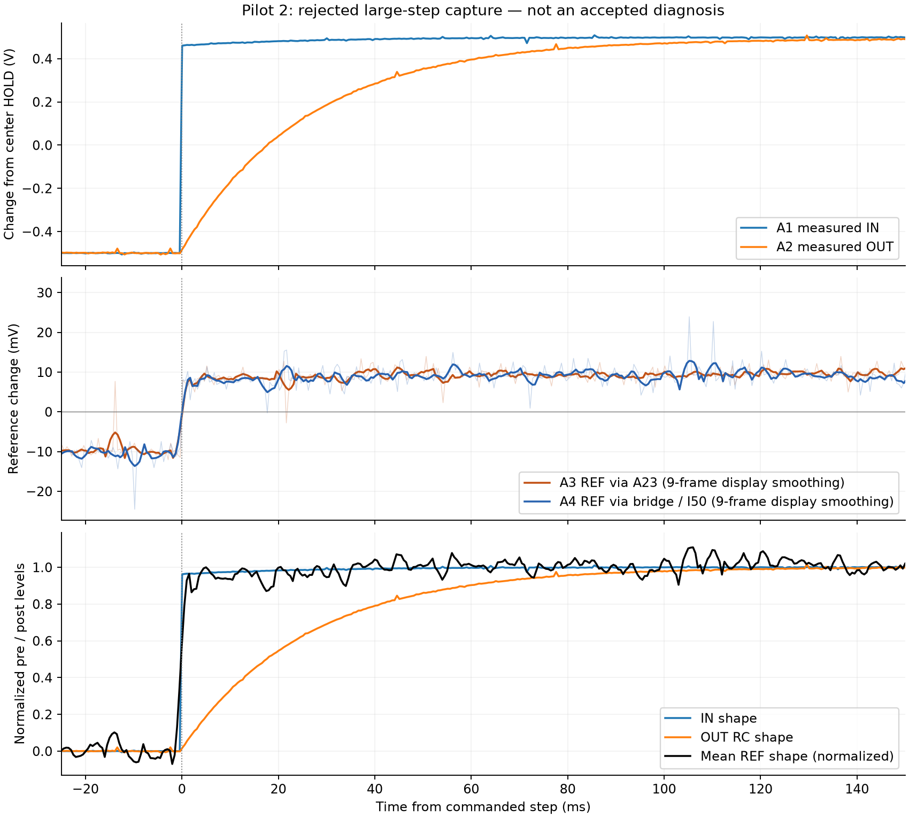
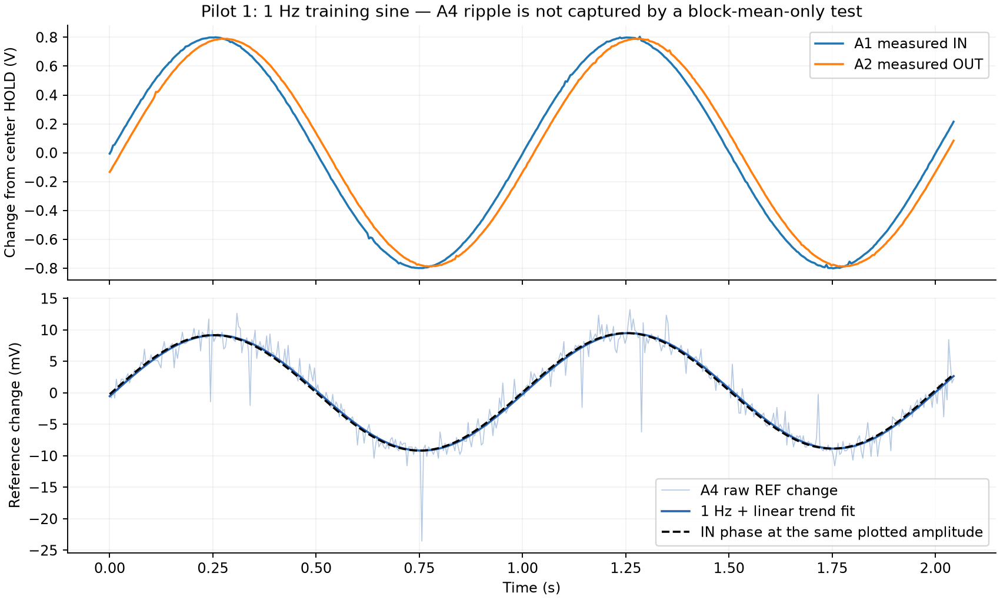

# Nov 3 REF 조사 — 기존 로그만 분석

**입력에 연동된 공통 변화는 뚜렷하지만, 이 로그만으로 ADC 착시와 실제 REF 이동을 확정할 수는 없다.**
큰 스텝에서 REF 채널은 느린 RC 출력보다 빠른 IN 모양을 더 잘 따른다. 1 Hz 사인에서도 입력과
거의 같은 위상의 성분이 보인다. 그러나 실제 REF가 구동 신호나 전원과 결합해도 같은 패턴이
가능하다. 아침에는 ADC와 독립적인 멀티미터로 지속 DC 상태를 비교해야 한다.

사용자의 취침 지시 이후 Spark 호출 **0회**, 하드웨어 명령 **0개**, 배선 변경 요청 **0건**이다.
진단 실행기·펌웨어·3 mV 기준은 바꾸지 않았다. 아래 아침 절차는 **준비안이며 실행하지 않았다**.
사용자가 돌아오기 전 자동 실행하지 않는다.

## 두 design-01 파일럿의 상태

| 신호 측정이 있었던 파일럿 | 훈련에서 좁혀진 설명 | 중단 위치 | 판정 |
|---|---|---|---|
| `20261102T160841-eff2b65334` | 직렬 경로 R 증가. C1=1 µF 가정의 실효 R1 약 25.17 kΩ. 훈련 3개 통과 | 첫 예약 스텝 취득 뒤 A4 블록 평균 범위 4.368 mV로 3 mV 초과 | 파일럿, 집계 제외. 예약 검증·최종 보고 미완료 |
| `20261102T164944-16f6a79a31` | 직렬 경로 R 증가. C1=1 µF 가정의 실효 R1 약 24.85 kΩ. 부하 스텝 통과 | 다음 큰 무부하 스텝 취득 뒤 REF 가드 실패. A3·A4가 함께 이동 | 파일럿, 집계 제외. 예약 검증 전 중단 |

두 번 모두 **훈련 가설은 직렬 R 증가로 좁혀졌고, 중단은 REF 보호 검사 때문**이다.
R1 자체가 바뀌었는지 보드 밖 저항이 추가됐는지는 이 단자 측정으로 구별하지 못한다.
최종 검증된 진단이나 수리 성공으로 기록하지 않는다.

그보다 앞선 `20261102T154657-b43e7683e7`은 첫 HOLD에서 A4가 약 0.870 V로 읽혀 중단된
시작 점검 기록이다. 훈련 파형이나 R 추론이 없으므로 위 두 진단 파일럿과 구분해 보존했다.
HOLD-only 계측 QA의 실패 1건과 통과 1건도 별도 기록이다.

## 관측값과 의미

아래 전압은 기존 프로토콜의 ADC 명목 환산이다. 독립 멀티미터 실측값으로 취급하지 않는다.
모든 원시 로그의 종료 이벤트·해시 체인을 검사했다. 분석 대상은 위 두 파일럿의 자극 파형 6개다.

### 큰 스텝: 7 mV와 19–20 mV는 다른 비교다

두 번째 파일럿의 ±0.5 V 무부하 스텝:

| 지표 | A3, A23에서 읽은 REF | A4, D50–G50/I50 경로의 REF |
|---|---:|---:|
| 중심 HOLD 3블록 평균 대비 자극 블록 평균 | +7.397 mV | +7.068 mV |
| 음의 정상 구간 → 양의 끝 구간 | +18.659 mV | +19.879 mV |
| IN 모양+선형 시간 추세로 설명한 R² | 0.888 | 0.872 |
| OUT 모양+같은 시간 추세로 설명한 R² | 0.669 | 0.659 |

IN은 빠르게 바뀌고 OUT은 RC 응답으로 천천히 오른다. REF 채널 둘은 빠른 IN 쪽과 더 닮았다.
두 REF 채널의 행별 상관은 0.877이다. 이는 A4 선 하나에만 생긴 변화라는 설명으로는 부족하다.
같은 ADC 안의 두 채널이므로 독립 전압계 두 대가 실제 REF 이동을 확인한 것과 같지는 않다.

표의 정상 구간은 스텝 전 5:46 프레임과 마지막 100프레임이다. 형상 회귀는 실제 채널별
취득 시각에 맞추고 스텝 ±1 ms를 제외했다. 선형 시간 추세도 함께 맞췄다. R²는 설명력 비교이며
원인 확률이나 통계적 확신도가 아니다. 그림의 9프레임 평활화는 표시용이고, 수치에는 쓰지 않았다.
평활화 그림에서 미세한 선후관계를 판정하지 않는다.

### 사인: 통과한 블록에도 입력에 연동된 REF 성분이 있다

첫 번째 파일럿의 무부하 1 Hz, 명령 진폭 약 0.8 V 사인:

- A4의 1 Hz 성분 진폭은 **9.248 mV**다. 진폭이므로 약 18.50 mV p-p에 해당한다.
- A1 입력보다 위상이 약 **1.97° 늦고**, OUT보다 약 **7.54° 앞선다**.
- 이 성분과 선형 시간 추세가 A4 변화의 R² **0.927**을 설명한다.

단순히 RC 출력 전류에 따른 짧은 충전 펄스만 생겼다는 설명과는 잘 맞지 않는다. 입력에 연동된
측정 간섭 또는 실제 전기적 결합이 더 잘 맞는 기술이다. 두 범주 중 어느 쪽인지는 아직 모른다.

현재 3 mV 검사는 같은 배선/부팅 구간의 **블록 평균들 사이 범위**를 제한한다. 모든 REF 샘플의
리플 진폭을 3 mV로 제한하는 검사가 아니다. 거의 영평균인 사인 성분은 블록 평균에 잘 드러나지
않는다. 따라서 HOLD·작은 스텝·사인 블록이 통과했다는 사실이 REF 오차가 없다는 뜻은 아니다.
작은 부하 스텝이 통과했던 두 번째 파일럿에서도 A4의 음·양 정상 구간 차이는 약 4.39 mV였다.
이 설명은 기존 판정의 의미를 밝힌 것이며 기준을 바꾼 것이 아니다.

### 샘플링에서 확인한 것

보존된 펌웨어는 **A1 → A2 → A3 → A4** 순서로 읽는다. 실제 완료 지연의 중앙값은 각각
약 52 / 105 / 158 / 215 µs였다. 사인 위상 계산에는 채널별 실제 시각을 사용했다.
샘플 상태는 요청값과 취득 전후 readback 모두 255였다. 현재 로그에는 샘플링 시간·버림 변환·
채널 순서를 바꾼 대조 시험이 없다. 그 변경이 해결책이라는 결론까지 내릴 수 없다.

## 두 가설을 어디까지 가를 수 있나

| 설명 | 로그가 지지하는 부분 | 남는 한계 |
|---|---|---|
| ADC 다중화·변환 경로 간섭 | REF 채널에 입력 모양·부호에 연동된 성분이 있고, 사인 위상도 입력에 가깝다 | 같은 패턴은 실제 전원/REF 결합으로도 가능하다. 입력을 따라간다는 사실만으로 착시라고 확정할 수 없다 |
| 단순한 직전 채널 잔류만으로 발생 | 첫 파일럿에서 A4 직전 채널 A3는 DRIVE였다 | A3를 REF로 옮긴 뒤에도 A3·A4가 함께 빠른 IN 모양을 따른다. A3 바로 앞의 느린 OUT만 잔류한다는 단순 모형으로는 부족하다 |
| REF 실제 이동 또는 전원·접지 결합 | 위쪽 REF를 읽는 A3와 다른 경로의 A4가 함께 이동한다 | 두 값 모두 같은 ADC의 결과다. 외부 전압계 없이 실제 물리 전압인지 공통 변환 오차인지 확정할 수 없다 |

두 현상이 동시에 있을 가능성도 로그만으로 배제할 수 없다. 현재 결론은
**입력에 연동된 공통 변화가 확인됐고, 원인 분리는 독립 계측이 필요하다**이다.

수학적으로도 단자 로그만으로 같은 모양을 만들 수 있다. 입력을 u, RC 전달 연산을 H,
실제 REF 이동을 r=k·u라고 놓으면 출력은 `H·u + (1−H)·k·u`다.
REF는 고정되어 있지만 출력 측정에 입력이 k만큼 섞이는 모형은
`(1−k)·H·u + k·u`다. 두 식은 같다. 이는 실제 k나 ADC 원인을 추정한 결과가 아니라,
상관과 파형만으로 원인을 확정할 수 없는 이유를 보인 예다.

## 아침의 멀티미터 확정 절차 — 아직 실행하지 않음

사용자가 돌아와 준비 상태를 알린 뒤 진행한다. 밤 동안 자동 실행하거나 추가 배선 요청을
보내지 않는다. 현재 USB 전원 상태는 새로 확인되지 않았으며, 잠들기 전 핀 통전 검사는
금속 접점 접근이 어려워 수행하지 못했다. 풀다운 유무도 새로 확인된 것이 아니다.

### 1. 현재 배선과 측정 범위 고정

첫 비교는 지금의 DUT와 A23–A45, I50–A4, D50–G50, B50–B23, B28–B35의 1 kΩ을 유지하고
E30–A55 부하는 없는 상태에서 한다. ADC/REF 경로를 동시에 바꾸지 않는다.
멀티미터는 D50 대 기존 파란 GND, 가능하면 **DC 2 V 범위의 1 mV 표시**를 사용한다.
이전의 `1.63 V` 두 값은 범위·해상도가 기록되지 않아 3 mV 이내 안정성을 증명하지 않는다.
처음에 실제 공급 전압과 표시 범위도 기록한다. 미터의 절대 정확도가 검증됐다고 주장하지 않는다.

### 2. 짧은 CAPTURE 대신 지속 DC로 같은 부팅에서 비교

현재 펌웨어에는 `DC <boot> <code>`가 이미 있다. 응답 후 출력을 유지하므로 멀티미터를 읽을 수
있다. `CAPTURE`, HOLD 포함, 는 취득 뒤 REF로 돌아가므로 짧은 스텝이 끝난 뒤 미터를 재는
방식은 이 비교에 맞지 않는다. 펌웨어 업로드는 필요 없다.

| 표기 | 구동 쪽 명목 목표 | 현재 프로토콜에서 계산한 DAC 코드 |
|---|---:|---:|
| C | 1.646 V | 1376 |
| L | 1.146 V | 958 |
| H | 2.146 V | 1793 |

바꾸는 것은 DAC/IN 쪽 DC이며, D50은 고정되어야 할 REF를 읽는다. 위 값은 기존 4.9 V
프로토콜의 명목 코드다. 아침의 프로토콜·새 부팅·ARM 한도와 다시 대조한 뒤에만 쓴다.

순서는 **C → L → C → H → C**, 다음 반복은 **C → H → C → L → C**다. 배선과 부팅을
유지해 순서·예열·USB 재연결 영향을 줄인다. 각 수준은 확인 응답 후 5초 기다리고, D50을
2초 간격으로 세 번 기록한다. 표시값을 반올림해 없애지 말고 범위와 함께 남긴다.
ADC의 A3·A4 평균도 같은 수준에서 기록한다. ADC 취득을 추가한다면 DMM 판독 뒤 같은 수준의
QA HOLD를 사용하고, 취득 끝에 REF로 복귀한다는 사실을 기록한다. 마지막은 REF 복귀 확인이다.

기존 Python `set_dc_level`은 로그에 "DUT disconnected" 범위를 쓴다. DUT를 유지하는 이번
시험에 그것을 그대로 실행해 부정확한 범위를 남기지 않는다. 아침에는 DUT 유지·코드 범위·
중단 조건을 명시한 별도 QA 기록기로 기존 DC 명령을 연결한다. 이 문서는 실행 승인이 아니다.
새 QA 자료는 진단 훈련이나 예약 검증 자료로 합치지 않는다.

### 3. 결과에 따른 분기

| 독립 전압계와 ADC의 관측 | 다음 판단 |
|---|---|
| D50이 구동 부호에 따라 반복해서 수 mV 이상 움직이고 ADC도 같은 방향 | 실제 REF/전원/접지 이동의 기여가 확인된다. 공급 전압과 U1 REF 출력·입력 경로를 조사한다. U1 칩 자체 고장으로 곧바로 단정하지 않는다 |
| D50은 안정적인데 ADC가 지속 DC에서도 움직임 | 같은 절차를 G50에서 반복해 브리지 뒤 물리 전압도 확인한다. 가능하면 Arduino 쪽 GND 대 파란 GND 차이와 ADC 입력 접점도 확인해 경로/접지 변화를 분리한다 |
| D50·G50 및 관련 접지 전압은 안정적인데 ADC만 반복해서 움직임 | 측정/변환 경로 간섭이 강하게 지지된다. ADC 다중화 자체를 특정하려면 버림 변환·순서의 통제된 대조가 더 필요하다 |
| 지속 DC에서는 모두 안정적 | 원래의 빠른 과도 현상은 미확정이다. 느린 멀티미터 결과만으로 0.25초 이내 물리 REF 이동을 배제하지 않는다. 더 빠른 독립 기록 또는 별도 샘플링 대조가 필요하다 |

3 mV와 비교하려면 미터의 표시 해상도와 반복 변동을 함께 본다. 한두 표시 자릿수 차이만으로
정밀 판정하지 않는다. 물리 이동이 확인되면 버퍼·전원 경로를 먼저 고치고, 측정 간섭이면
계측 경로를 고친다. 기준을 넓혀 이전 실패를 통과로 바꾸지 않는다.

샘플링 변경이 필요하면 동결 펌웨어를 복제한 새 버전에서만 시험한다. 버림 변환이나 순서 변경은
채널 취득 시각과 주기를 바꾸므로 타이밍도 다시 검증해야 한다. 기준·측정 정의를 바꿀 근거가
생기면 **다음 실행 전 amendment와 새 프로토콜을 고정**한다. 지금은 어느 것도 바꾸지 않았다.

## 재현과 보존

[분석 코드](../experiments/analyze_ref_coupling.py)는 공개 보존 로그만 읽고 네트워크·시리얼을
사용하지 않는다. [원시 수치와 입력 해시](../examples/ref-investigation/2026-11-03/metrics.json),
표시용 그림과 소스 사본을 함께 보존한다. 사인 진폭·위상·추세 계산은 알려진 합성식으로 확인했고,
공개 아카이브에서 다시 계산한 여섯 파형 수치가 최초 로그 분석과 정확히 일치했다.
기존 실행 소스 76개의 해시도 그대로다.

이번 작업의 새 유료 호출·하드웨어 명령은 0이다. 새 세션 진행 누적은 **Spark 16회,
토큰 기반 추정 $0.1141413**이며 계정 청구서 확정 금액은 아니다. 두 진단 파일럿과 이전 시작
점검, 실패한 QA도 모두 보존한다. 수리·정상 재실행은 아직 완료하지 않았다.
