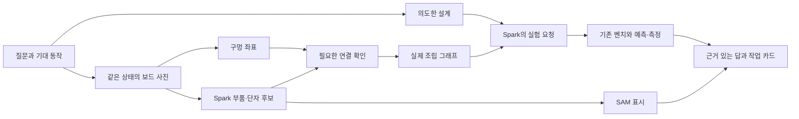

# BenchMate 사진 기반 벤치 — 구현 계획 v1

작성: 2026-11-02 KST. 기준 코드: `bdb2191ecb3f1e8415a218209c50e4de04f9c5d5`.
상태: **구현 전 계획**. 이 문서의 목표·통과 기준은 아직 달성한 결과가 아니다.

## 1. 만들 제품과 첫 완성 범위

사용자가 회로에 대해 질문하면, BenchMate가 설계 자료와 실제 조립 상태를 구분해 읽고,
부족한 사진이나 측정을 요청하고, 실험 결과를 근거로 답한다. 필요한 작업은 사진의
부품과 구멍 주소로 보여준다. 수리 완료는 사진 판독이 아니라 수리 후 측정으로 판단한다.

첫 완성 범위는 **현재 170홀 미니보드, R·C·다이오드·점퍼, 기존 IN/OUT/REF 픽스처**다.
큰 830홀 계측 보드는 검토된 픽스처로 취급하고, 사진으로 전부 역설계하지 않는다.
지원하지 않는 회로도 사진 검토는 할 수 있지만, 자동 계측·수리는 지원 범위에서만 연다.

첫 장면의 목표:
“왜 이 필터가 느린가요?” → 의도한 설계 확인 → 실제 보드의 부품·연결 후보 확인 →
Spark가 실험 요청 → 기존 벤치 측정 → 결과에 근거한 수리 요청 → 사진에서 대상 표시 →
작업자 완료 → 수리 후 검증. 기록 재생은 항상 **Replay**로 표시한다.



기존 D01 실물 수리와 B5 실행은 별도로 유지한다. 이 기능의 완성을 기다리느라
이미 준비된 실물 실험을 미루지 않는다. 새 사진 흐름을 과거 실행에 붙여서 당시 기능처럼 보이지 않는다.

## 2. 기술 선택 — 이 버전에서는 고정

| 역할 | 선택 | 구현 결정 |
| --- | --- | --- |
| 사진 읽기·부품 위치·질문 이해 | Meta `muse-spark-1.3`, Responses API, Standard | 첫 비전 시험은 max. 일반 질문은 medium, 구조 변경·실험 선택은 max. 기존 동결 실행기의 추론 설정은 변경하지 않는다. |
| 부품 강조 표시 | Meta `sam-3.1` API + `meta-sam-parser==0.1.0` | 검토한 box/point로 요청. 마스크는 표시용이며 접점 판정에 쓰지 않는다. |
| 보드 구멍 좌표 | Python 3.11, OpenCV, NumPy | 평면 변환 + 규칙 격자. 첫 버전은 방향·기준점 사용자 확인을 허용한다. |
| 이미지 준비 | 기존 Pillow 정규화·PNG 검증 | EXIF 회전 적용 후 메타데이터 없는 PNG. 최대 변 1600px 유지. 작은 접점은 확대 보간 대신 근접 사진 요청. |
| 연결 계산 | Python dataclass + 명시적 JSON 검증 + union-find | 보드 내부 연결표와 확인된 단자·점퍼로 그래프 계산. LLM이 내부 연결을 임의로 만들지 않는다. |
| 전기 모델·실험 | 기존 SciPy/ngspice, D01/B5 실행기, pyserial | 초기에는 기록 읽기, 이후 허용된 실행기만 연결. 새로운 임의 회로 제어는 제외. |
| 사용자 화면 | 기존 HTML/CSS + JavaScript ES modules + SVG | 사진 위 구멍·부품·선 표시, 대화·확인 카드. React/Next.js로 재작성하지 않는다. |
| 로컬 서버 | Python `ThreadingHTTPServer` + 작업 큐 1개 | loopback 전용, 세션 토큰·origin 검사. 무거운 작업은 큐에서 실행하고 화면은 500ms 간격으로 새 이벤트를 읽는다. |
| 저장 | 세션별 JSON + 기존 `Recorder` 해시 연결 JSONL | 사진·후보·사람 수정·모델 응답·측정 출처를 별도로 보존. DB/클라우드 계정 시스템은 추가하지 않는다. |
| 공개 데모 | 기존 GitHub Pages 빌드 | 정제한 결과만 정적 공개. 실물 USB 실행은 로컬 앱에서만 제공. |

새 선택 의존성은 OpenCV와 공식 SAM 파서다. 설치 단계에서 Mac arm64/Python 3.11
호환 wheel과 기존 NumPy 범위를 확인하고 **실제 설치 버전을 lock에 고정**한다.
공용 환경을 깨는 설치는 하지 않고, 충돌하면 새 선택 환경에서 실행한다.
사진·언어 AI는 Meta만 쓴다. OpenCV·그래프 계산·ngspice는 AI 모델이 아니다.

VGGT-Ω·CoTracker·SAM 3D/GenIA는 이번 필수 경로에서 제외한다. 여러 장의 사진은
우선 각 사진을 동일한 보드 좌표계에 맞춰 결합한다. 가려진 배선을 3D 생성으로 복원하지 않는다.
필수 단계가 완료되고 그 방식의 구체적인 실패 사례가 남을 때만 별도 연구 대상으로 연다.

## 3. 실제 코드에서 확인한 출발점

- `known_design.py`에 이미지 정규화·Spark 전사·명시적 설계 검토가 있다.
  조립 사진을 정상 설계로 승격시키지 않는 현재 제한을 유지한다.
- `known_design_web.py`는 로컬 사진 검토와 별도 D01 기록 재생을 연결한다.
  범용 대화·다중 사진·구멍 배열·사진에서 실물 실행은 아직 없다.
- IMG_8885의 실제 Spark 결과는 1µF 표시를 읽었지만 모든 단자를 UNKNOWN으로 남겼다.
  부품 box도 어긋났다. 이 좌표를 그대로 수리 대상에 쓰지 않는다.
- SAM의 기존 `capacitor` 결과는 0개. 별도 `blue rectangular component`는 몸통만 찾았다.
  box/point 방식은 **새 개발 시험**으로 기록하며 이전 실패를 덮지 않는다.
- 기존 D01 실행기는 `operator-request.json`과 요청별 응답 파일을 통해 사람을 기다린다.
  웹 연결은 이 계약을 감싸고, 기존 실행기·펌웨어·프로토콜을 수정하지 않는 쪽으로 한다.
- 현재 사진은 서로 다른 조립 상태일 수 있다. 같은 시편의 여러 각도라고 자동 묶지 않는다.

## 4. 데이터 구조와 좌표 계약

스키마 이름은 `benchmate.photo_session.v1`. 세션에 다음을 분리해 저장한다.

| 자료 | 필수 내용 |
| --- | --- |
| `intent` | 질문, 기대 동작, 의도한 설계의 출처. 설계가 없으면 unknown 가능. |
| `capture_set` | 시편 ID, 조립 상태 revision, 같은 상태 촬영에 대한 확인, 사진별 정제 hash·크기·시점 |
| `board` | board ID, 템플릿, 방향, 기준 구멍, 평면 변환, 오차, 내부 연결표 출처 |
| `holes` | `mini:A1` 같은 전역 ID, 보드 좌표, 사진별 투영점, 관측된 점유 상태, 근거 |
| `components` | R/C/D/wire/unknown, 읽은 문자·값·단위, 사진별 box·mask, 단자 목록 |
| `terminals` | 부품 ID·단자 ID, 후보 구멍 목록, 삽입 지점 관측, 가림·상충 여부, 사람 수정 이력 |
| `assembly_graph` | 확인된 연결과 미확정 연결, 도출한 node, 그래프 revision/hash |
| `experiment` | 지원 여부, 실행 ID, 관측·예측·판정 링크. 사진 추정과 독립 |

`holes`는 모든 칸을 가지되, 상태는 `unknown / observed_empty / observed_occupied`다.
보이지 않는 구멍을 비어 있다고 기록하지 않는다. 값의 상태도 `unreadable / read / reviewed`를 분리한다.
사진에서 보임, 사람이 확인함, 전기 검사로 지지됨은 각각 근거 속성이며 한 개의 “확신도”로 합치지 않는다.

좌표는 다음처럼 명시적으로 변환한다.

1. 기존 비전 기록의 box는 프롬프트 계약상 **0–1**이다. 기록을 다시 해석하거나 수정하지 않는다.
2. 새 Spark 위치 프롬프트는 **0–1000**으로 고정하고 `coordinate_space`를 저장한다.
3. 내부 표시·SAM 어댑터는 전송한 PNG의 **실제 픽셀 좌표**를 쓴다. crop을 쓰면 변환·원본 hash를 기록한다.
4. SAM wire-format box 끝점은 inclusive다. 파서가 내놓는 raster/slice의 exclusive 끝점과
   별도 변환한다. 기존 파서 버전에서 원본 응답→마스크 크기를 회귀 검사한다.
5. 화면 축소·여백·확대 이동·EXIF 회전까지 역변환한다. 모델이 만든 HTML/스크립트는 실행하지 않는다.

170홀 템플릿: 중앙 홈 가로, 위 A–E·아래 F–J, 왼쪽부터 1–17.
F는 홈 바로 아래다. A–E 같은 번호 다섯 개가 한 접점 그룹이며 F–J는 별개다.
중앙 홈의 간격은 일반 구멍 간격과 구분한다. 큰 보드 주소와 혼동하지 않게 `mini:`/`fixture:`를 붙인다.
이것은 검토된 템플릿 가정이며 사진으로 내부 금속 연결을 측정했다는 뜻은 아니다.

## 5. 구현 순서와 단계별 완료 기준

예상 시간은 구현 시간의 범위이며 API 대기·새 사진·실물 작업 시간은 별도다.
단계가 끝날 때 산출물과 검증 결과를 저장하고 해당 변경만 커밋한다.

### P0 — 계약·자료·평가 고정 (약 30–60분)

- 새 패키지 `src/benchmate/photo_bench/`를 준비한다. 계약·보드 템플릿·fixture 데이터부터 만든다.
- 시작 사진은 이미 공개된 IMG_8885 정제 PNG 하나. hash를 고정하고 원본 폴더는 읽어 들이지 않는다.
- 검토용 정답은 모델 입력과 분리한다. 기존 조립 문서는 좌표 관례의 출처로만 사용한다.
  사진마다 실제 단자가 보이는지 별도 확인하며, 조립 표를 사진 정답으로 복사하지 않는다.
- 완료: 세션 schema, 170홀 템플릿, 좌표 변환 검사, 첫 사진 manifest와 평가 규칙 저장.
  API·USB 사용 0회. 이 단계에서 보호 파일들의 hash 기준선도 남긴다.

### P1 — 구멍 주소가 붙은 실제 사진 화면 (약 2–3시간)

- 사진 선택 → 미니보드 영역/방향 확인 → 서로 떨어진 기준 구멍 지정 → 전체 격자 표시.
- 기본 기준점은 A1·A17·J1·J17. 가려졌으면 다른 이름 있는 구멍을 고른다.
  OpenCV `findHomography`와 가시 구멍의 검은 영역 중심으로 정합을 보조한다.
  기준점이 부족하거나 정합이 불안정하면 자동 성공으로 표시하지 않는다.
- SVG로 구멍을 클릭하면 주소를 표시한다. 부품에 가려진 칸도 투영 위치와 가림 상태를 구분한다.
- 완료: fitting에 안 쓴 최소 20개 가시 구멍을 네 모서리·중앙에 걸쳐 고정해 검사.
  주소 일치 20/20, 투영 오차 p95 ≤ 해당 위치 구멍 간격의 0.25배를 개발 관문으로 둔다.
  보드를 뒤집거나 회전한 사례에서 주소 방향을 잘못 확정하지 않는지도 확인한다.
- 실패하면 기준점 수동 보정 화면을 유지한다. “자동 구멍 인식” 성능으로 집계하지 않는다.

### P2 — Spark가 읽고 SAM이 표시 (약 1–2시간)

- 새 `spark_vision.py`로 부품 종류·표시 문자·몸통 위치·관측 가능한 다리 삽입점을 요청한다.
  단자가 가려졌으면 null과 필요한 추가 시야를 반환하게 한다.
- 먼저 결과와 불확실성을 화면에 표시한다. SAM에 보낼 위치를 검토한 뒤
  `sam_overlay.py`가 box/point로 몸통을 분할한다. SAM 실패 시 일반 box 표시를 유지한다.
- 첫 별도 시험은 **Spark 1회 + SAM 1회**로 두 부품을 확인한다.
  SAM 한 요청에 검토한 두 object ID를 넣는다. 추가 요청은 별도 개발 시도로만 기록한다.
- 완료: 원본 모델 출력·오류·0개 결과 포함 보존, 0–1000↔픽셀↔화면 변환 통과,
  resistor/capacitor 각각 올바른 대상 표시 여부와 사람 보정 횟수 기록.
  이 결과가 몸통 표시만 성공했다면 단자 인식 성공으로 세지 않는다.
- 모델 기반 위치가 불안정하면 “사용자가 찍은 부품을 SAM이 표시”로 기능을 좁힌다.

### P3 — 단자 후보 → 검토 가능한 넷리스트 (약 2–3시간)

- 먼저 사진 한 장에서 부품 다리의 **보드 삽입 지점**과 구멍 후보를 연결한다.
  높이 떠 있는 몸통·선 중앙은 평면 변환으로 구멍에 붙이지 않는다.
- 후보가 겹치거나 가림이 있으면 확대 보기와 선택 카드로 한 곳씩 확인한다.
  최근접 구멍이라는 이유만으로 자동 확정하지 않는다. 수정 전/후와 출처를 모두 남긴다.
- 보드 내부 접점과 점퍼만 union한다. 저항·커패시터·다이오드는 node 사이의 소자다.
  값 미확정은 symbol/null로 남긴다. REF를 GND로 바꾸지 않는다.
- `assembly_graph.py`에서 검토된 그래프를 만들고 `netlist_adapter.py`로 제한된 R/C/D 넷리스트를 낸다.
  시뮬레이터에는 허용 소자·수치·node만 전달하며 외부 파일/임의 명령은 허용하지 않는다.
- 완료: visible/occluded/shorted/missing-value/두 보드 주소 충돌 fixture 통과.
  실사진의 네 R/C 단자는 전부 **정확한 구멍 또는 미확정**으로 남아야 한다.
  사람이 채운 단자는 모델 정답률에서 제외하지 않고 별도 assisted 결과로 보고한다.
- 의도한 설계와 실제 연결을 나란히 보여준다. 설계가 없으면 기대 동작을 먼저 묻고,
  현재 동작을 설명하는 데 필요한 연결·값부터 확인한다. 처음부터 회로 전체 확정을 강요하지 않는다.

### P4 — 여러 각도 사진을 동일한 보드에 결합 (약 2–3시간, 새 자료 필요)

- 같은 배선을 유지한 위·왼쪽 사선·오른쪽 사선 사진 3장을 한 capture set으로 받는다.
  이 사진 세트는 아직 확보되지 않았다. 기존 서로 다른 상태 사진으로 대체하지 않는다.
- 각 사진에 독립적인 board-plane 변환을 구한다. Spark에는 사진 ID와 동일 상태라는 조건을 주고
  1회 다중 이미지 요청으로 동일 부품 대응·단자 후보를 얻는다. 이미지 hash와 상태 revision을 붙인다.
- 같은 구멍 ID에 대한 관측을 합치되 충돌은 해소 전까지 유지한다.
  위에 떠 있는 같은 부품의 몸통 위치를 homography만으로 대응시키지 않는다.
- 가려진 곳은 “C2의 오른쪽 다리가 보이도록 오른쪽에서 한 장”처럼 필요한 시야만 요청한다.
  같은 색 점퍼/동일 부품 두 개는 외형만으로 ID를 확정하지 않는다.
- 완료: 단일 사진·3장 사진의 정확한 단자 수, 미확정 수, 잘못 확정한 수, 사람 보정 수를 함께 보고.
  같은 회로를 여러 장 찍은 것은 독립 회로 여러 개로 세지 않는다.
- 잘못된 자동 확정이 생기면 자동 병합을 끄고 사진별 후보 확인으로 축소한다.
  새 사진이 없으면 이 단계는 대기하고 P5의 기록/모의 연결은 계속할 수 있다.

### P5 — 대화 → 근거 → 기존 벤치 흐름 연결 (약 2–3시간)

- 질문 카드: 회로도 있음 / 없음 → 기대 동작·문제 증상 → 사진·설계 검토.
  화면은 자유 대화를 받되, 실제 상태 변경은 검증되는 명시적 도구 호출만 수행한다.
- 새 `session.py` 상태 기계와 `controller.py`의 도구:
  `inspect_session`, `request_view`, `request_terminal_review`, `compare_design`,
  `request_supported_experiment`, `explain_result`. 모델은 shell/serial에 직접 접근하지 않는다.
- `bench_bridge.py`는 처음에는 기존 실행 기록과 mock만 읽는다. 그다음 동일 화면에서
  기존 D01 실물 실행기의 요청을 표시하고 실제 사람 응답만 요청 ID별로 넘긴다.
  사용자가 누르지 않은 확인을 자동 생성하거나 이전 실행 확인을 재사용하지 않는다.
- 실행 시작은 allowlist된 고정 CLI 인수·새 run 폴더만 허용한다. 코드·프로토콜 hash,
  검토된 정상 설계, 실제 초기 배선 보고와 fresh-boot 등 기존 조건을 모두 유지한다.
  D01 runner가 받지 않는 무회로도/임의 넷리스트는 실행하지 않고, 설명·추가 증거 요청으로 남긴다.
- 계측은 동시 1개이며 서버 새로고침·재시작으로 재실행하지 않는다. 분리·중단은 실행기에 위임하고,
  재개에는 현재 요청과 하드웨어 상태를 다시 연결한다. “중단”이 즉시 무전원을 뜻한다고 표시하지 않는다.
- 수리 표시 조건: 실행기가 요청한 action + 해당 조립 revision + 확인된 부품/단자 ID 일치.
  현재 D01의 I8–I13 대상은 새 사진에서 실제 확인되었을 때만 강조한다. C 두 개가
  전기적으로 동등해도 사진만 보고 원래/추가 C를 단정하지 않는다. 위치 불명 시 기존 구멍 안내 사용.
- 완료: scripted mock으로 처음부터 끝까지, 과거 물리 기록 Replay, 잘못된/오래된 확인 거절,
  API 중단·USB 끊김·사람 취소 경로 확인. 실제 실행 성공은 새 실물 기록이 생겨야 별도 완료다.
- 기존 물리 runner로 넘어갈 때 사진의 결함 정답을 주입하지 않는다. 정상 설계·측정 요약만 받는
  기존 계약을 유지하고, photo-assisted 실행은 기존 blind 진단 성적과 합치지 않는다.

### P6 — 한 화면의 제품 경험·공개 데모 (약 1–2시간)

- 데스크톱: 왼쪽 대화, 가운데 사진/회로 탭, 오른쪽 다음 작업·측정 결과.
  모바일: 같은 내용을 대화 → 사진 → 다음 작업 순으로 한 열에 배치한다.
- 눈에 보이는 단계는 “질문 → 회로 확인 → 실험 → 해결 확인”. JSON·해시·넷리스트는 Evidence로 보낸다.
  주요 결과에는 짧게 “사진에서 읽음 / 직접 확인 / 측정으로 확인” 출처를 붙인다.
- “부하 연결”과 “부품 제거”는 한 번에 한 장의 작업 카드. 필요한 구멍 두 곳과
  유지할 부품을 그림으로 보여주고, 실제 작업 후의 확인과 취소를 제공한다.
- Live/Replay와 Physical/Simulated는 독립된 상태다. 의도한 파형 사전 예측과
  실측 IN을 사용한 조건부 곡선은 생성 시점과 라벨을 각각 유지한다.
- 완료: 키보드·390px/1440px·확대·사진 회전·reduced motion·API-off 확인.
  공개 빌드는 정제된 세션만 포함하고 원본 사진/키/로컬 경로/유료 실행 버튼은 포함하지 않는다.

### P7 — 새 사진 세트 검증 후 자동화 범위 결정

- 개발 사진과 별개로 동일 지원 보드의 최소 3개 조립 상태를 사진 3장씩 확보한다.
  기본 RC / 커패시터 2개 / 점퍼나 극성이 다른 사례를 포함하고, 사람 정답을 모델 실행 전 고정한다.
- 개발 성공 사진만 고르지 않고, 모든 요청·실패·보류를 기록한다. 미니 파일럿으로만 보고한다.
- 지표: 부품 누락·오검출, 정확한 **단자 구멍** 수, 잘못 확정한 구멍 수,
  미확정 비율, node 연결 정확도, 보정 횟수, 완료 시간·요청 수·비용.
  마스크 점수와 전기 연결 정확도는 별도다. 사진 여러 장을 독립 회로로 부풀리지 않는다.
- 최소 20개 가시 단자를 포함한 새 파일럿에서 자동 후보의 정확도 ≥95%,
  잘못된 “확정” 0개, 가림·충돌을 숨기지 않음을 출시 전 개발 관문으로 둔다.
  미확정·사람 보정 비율도 함께 보고하며, 통과해도 일반적 신뢰도나 무확인 수리를 주장하지 않는다.
- 미달이면 사용자 확인형 제품으로 출시한다. 평가 중 기준을 낮추거나 성공한 사진만 공개하지 않는다.

## 6. 구현 파일과 기존 코드의 경계

계획된 새 파일(아직 구현되지 않음):

```text
src/benchmate/photo_bench/
  schema.py              # 명시적 자료 검증·버전
  boards.py              # 보드 template와 주소/내부 접점
  geometry.py            # 사진↔보드 변환, 오차와 가림
  spark_vision.py        # 새 다중 이미지/위치 프롬프트와 응답 검증
  sam_overlay.py         # box/point 요청과 좌표/파서 변환
  assembly_graph.py      # 단자 후보·검토·전기 접점 그래프
  netlist_adapter.py     # 제한된 모델 변환
  session.py             # 상태, revision, 기록
  controller.py          # 질문과 도구 호출 루프
  budget.py              # 이미지/SAM 전용 요청·비용 제한
  bench_bridge.py        # 기존 run/작업자 요청 계약 연결
  server.py              # loopback API, 단일 작업 큐
  app.html / app.css / app.js
  overlay.js             # SVG 사진 표시와 선택
scripts/photo_bench.py   # prepare / serve / evaluate, 기본 API-off
tests/test_photo_bench_*.py
examples/photo-bench/    # 검토 후 공개 가능한 개발·평가 산출물만
```

UI 경로는 `/session`, `/images/prepare`, `/board/register`, `/vision/read`,
`/terminals/review`, `/chat`, `/events?after=...`, `/bench/request`, `/operator/respond`로 나눈다.
서버가 세션·사진 ID에서 경로를 결정하며 클라이언트/모델이 임의 로컬 파일을 지정하지 못한다.
세션 상태는 `intake → mapping → needs_review → ready_for_analysis → awaiting_operator →
measuring → result`로 제한하고, 별도로 `blocked / cancelled / failed`를 둔다.
사진·연결·목표가 바뀌면 revision을 올리고 관련 검토·실험 준비 상태를 무효화한다.
물리 실행 중에는 해당 세션의 사진·그래프 편집을 잠근다. 배선 변경은 실행기가 요청한
작업 단계에서만 새 revision으로 기록하며, 임의 변경 보고는 다음 측정을 재개하기 전 중단 처리한다.
기록 재생은 이 상태 기계의 관측 전용 어댑터이며 작업자 응답을 기록하지 않는다.
기존 정상 설계 검토·기록 읽기 함수를 import하되, 동결 실행기와 공용 모델 코드를 고치지 않는다.
UI package data와 선택 의존성 추가는 별도로 명시하고 lock·CI를 검토한다.

## 7. 호출·저장·예산 정책

- 계획 작성과 P0/P1은 유료 호출·하드웨어 작동이 없다. 유료 단계는 준비한 이미지 hash,
  전송 내용, 모델·프롬프트, 요청 상한을 먼저 저장한다. 기존에 승인된 범위는 다시 묻지 않고 사용한다.
  새 이미지/목적이 승인 범위에 들어가는지 구분하며, 이 계획 자체를 무제한 전송 승인으로 삼지 않는다.
- 첫 P2 실험은 위의 2회. P4 한 세트는 Spark 1회와 선택적 SAM 최대 3회.
  추가 확인 이미지나 프롬프트 수정은 새 시도로 기록하고 숨은 재시도는 하지 않는다.
- 개발 1차 지출은 $5·외부 요청 12회 중 먼저 도달하는 한도로 계획한다.
  세부 요청의 최대 이미지 수·토큰을 고정하고 공식 요율에 따라 예약 후 사용량 정산한다.
  **기존 text-only 야간 장부는 이미지/SAM 비용 상한에 그대로 쓸 수 없다.**
  SAM은 이미지 과금 항목을 확인하고, 비용을 알 수 없으면 예약을 해제하지 않는다.
  실제 하드웨어 실행 예산과 분리한다. 이 액수는 신규 결제가 아니라 구현할 제한이다.
  P7의 최종 파일럿 호출은 이 1차 개발 분량에 포함하지 않으며, 자료 확보 뒤 별도 목록·상한을 고정한다.
- 기존 원본 `pictures/`와 `pictures-clean/`은 계속 git 제외. 모델에 보내는 것은 정제 PNG만,
  조립 정답·개인 경로·이전 진단·API 키는 사진 판독 입력에서 제외한다.
- 화면 설명과 실제 모델 인용을 구분한다. 수동 클릭·검토가 있었으면 자동화처럼 감추지 않는다.

## 8. 일정 압박 시 남길 것과 줄일 것

가장 먼저 확보할 최소 제품은 **P0–P3 + P5의 기록 연결 + P6**다.
다중 시야 자동 결합(P4), 새 사진 성능 평가(P7), 실제 웹 실행 연결(P5 후반)은
각각 필요한 자료와 관문을 통과한 뒤 붙인다. 덜 끝난 기능을 기존 증거의 필수 입구로 만들지 않는다.

1. SAM이 실패하면 box·구멍 표시를 남긴다.
2. 자동 단자 찾기가 실패하면 후보 선택·사람 확인으로 넷리스트를 완성한다.
3. 새 여러 각도 사진이 없으면 한 장과 수동 확인으로 제품 흐름을 완성한다.
4. 웹 실물 연결이 늦으면 기존 CLI로 실험하고 새 화면은 같은 run의 실제 기록을 읽는다.
5. 새 실물 결과가 없으면 Replay라고 보여준다. 과거 진단을 새 사진으로 검증했다고 표현하지 않는다.

첫 구현 착수 항목은 **P0 → P1: 기존 IMG_8885에 170개 구멍 주소를 겹쳐 보여주는 로컬 화면**이다.
여기까지 먼저 확인한 다음 Spark/SAM을 붙인다. 전체를 한꺼번에 만들며 결과를 기다리지 않는다.

## 9. 기술 근거와 기존 관측

기술 문서는 2026-11-02에 확인했다. 문서의 일반 기능은 우리 회로에서의 성능 보장이 아니다.

- [Meta 모델 목록](https://dev.meta.ai/docs/models): Spark 1.3 모델 ID·입력·추론 설정.
- [Meta image understanding](https://dev.meta.ai/docs/image-understanding): 다중 이미지와 정규화 위치 출력.
- [Meta SAM prompts](https://dev.meta.ai/docs/sam/segmenting): concept/box/point와 실제 미디어 좌표 계약.
- [Meta SAM parser](https://dev.meta.ai/docs/sam/client-libraries): Python 디코딩 경로.
- [OpenCV homography](https://docs.opencv.org/4.13.0/d9/dab/tutorial_homography.html): 평면 정합.
- [기존 사진 판독](../examples/photo-model-probe/2026-11-01/20261101T001812-2e9c1094fe/README.md).
- [별도 SAM 실험](../examples/sam-concept-probe/2026-11-01/20261101T063214-e48c4496e7/README.md).
- [미니보드 좌표](b1-assembly.md), [D01 추가 C 배치](d01-assembly.md).
- [정상 설계 검토](known-design.md), [현재 실물 준비 상태](morning-handoff-2026-11-02.md).

심사에서 보여줄 제품 근거는 “사진을 알아봤다”에 그치지 않는다.
**어느 연결이 불확실한지 보여주고, 필요한 증거를 요청하고, 실제 실험으로 결론을 확인하는 흐름**이다.
이번 확장은 그 흐름을 사용자가 따라갈 수 있게 만드는 데 집중한다.
