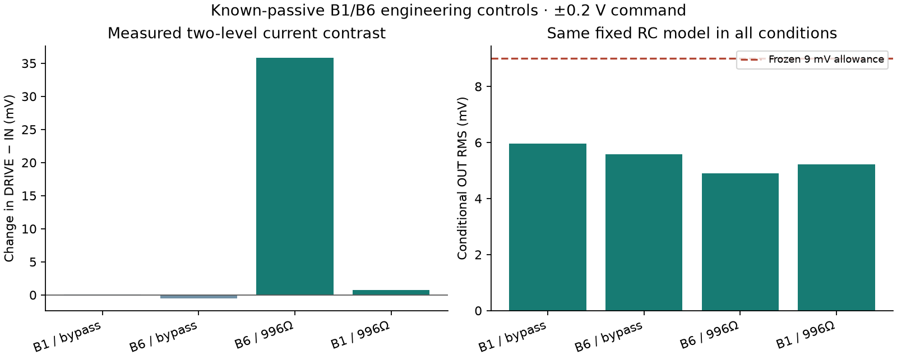

# B1/B6 physical gate — four known-passive controls passed

The operator removed the E30-A55 OUT-load jumper with USB disconnected and
reported a separate shunt of **996 ohm**. The 9.99 kohm resistor and its REF
return remain installed but disconnected at the OUT end.

The [common plan](plan-freeze/20261029T161106-4d79e30804/plan.json) is fixed before all
four conditions: B1 bypass, B6 bypass, B6 with shunt, B1 with the same shunt.
Both alternatives share the same measured-IN conditional OUT response, with
tau **10.15948 ms** fixed from the earlier pre-repair estimate and the
nominal repair C. Two settled step levels yield the A3-minus-A1 contrast.
The branch-plus-shunt model predicts **0.09066084 times measured DRIVE
excursion**, about **36.264 mV** for 0.4 V drive excursion;
the no-branch model predicts zero. Limits and control comparisons are frozen.

This is a known-passive, two-alternative engineering check, not full five-family
blind diagnosis, two independent DC captures or a calibrated detection limit.
The smaller +/-0.2 V stimulus is reported explicitly; the registered ideal
+/-1 V contrast of 181.8 mV is not being claimed here.

First requested state is restored B1 with jumper 11 retained and no load/input
branch. New shunt installation and later rewiring require their own USB-off
confirmation. The per-condition status below supersedes this initial preparation snapshot. All four controls are now recorded and pass the predeclared gate.

## Recorded conditions

| Condition | OUT RMS | A3−A1 level contrast | Supported alternatives |
|---|---:|---:|---|
| [b1_bypass](b1_bypass/README.md) | 5.952 mV | 0.029 mV | no_input_branch, input_branch |
| [b6_bypass](b6_bypass/README.md) | 5.588 mV | -0.547 mV | no_input_branch, input_branch |
| [b6_shunt](b6_shunt/README.md) | 4.907 mV | 35.814 mV | input_branch |
| [b1_shunt](b1_shunt/README.md) | 5.221 mV | 0.784 mV | no_input_branch |

## Completed gate

All four controls used identical fixed RC predictions, provisional channel maps,
guard limits and scoring rules. Both bypass controls left the input-branch
alternatives unresolved. With the same 996 ohm shunt, B6 supported the branch
and B1 supported no branch; each rejected the opposing current prediction.
B6 predicted 36.106 mV and measured 35.814 mV (error -0.292 mV).
B1 measured 0.784 mV against zero. Their difference is 35.029 mV; the B1 value
was not subtracted or fitted into either score.

All **10,240 frames** are retained: 2,048 scored and 8,192 stationary guard/origin
frames. Four distinct boots passed their continuity checks. Each condition is
one scored step block with two settled windows, not two independent DC captures.
No Spark calls, calibrated detection limit, blinded success rate or full D2
acceptance are implied. See the [aggregate and source hashes](summary/result.json).

