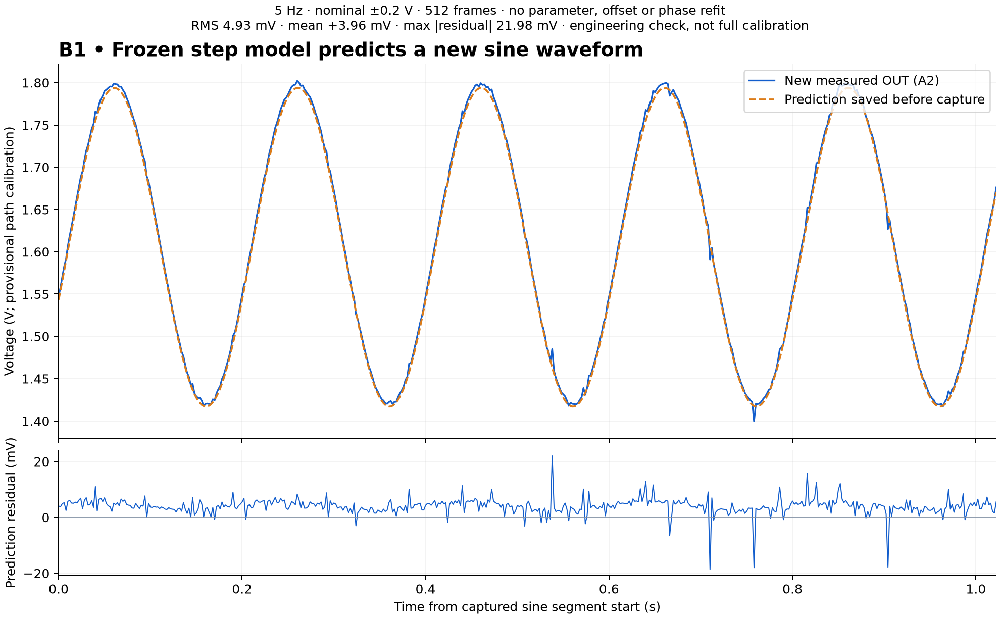

# B1 physical response and frozen prediction — October 29, 2026

A known passive RC now has a real step capture and a separately acquired
5 Hz sine check. The step-derived parameters and the entire sine prediction
were saved before the sine observation. No validation parameter, offset or
phase refit was performed. These are scripted engineering checks; Spark
was not invoked and no blind diagnosis or physical repair was performed.

| Check | Observed result |
|---|---|
| Step | Nominal ±0.2 V, 512 frames, 0.5 ms target, 497–503 us frame intervals, zero overruns |
| Effective tau fit | 10.113 ms; component-reading reference 9.830 ms (+2.88%) |
| Step fit residual | 1.496 mV overall RMS; 1.543 mV RMS in 0–50 ms |
| Window sensitivity | Pre-step plus first 50 ms fit gives 10.150 ms |
| New sine observation | 5 Hz, nominal ±0.2 V, 512 frames, 2 ms target, zero overruns |
| Frozen prediction residual | 4.931 mV RMS; mean +3.960 mV; maximum absolute residual 21.976 mV |
| Phase-region check | All eight RMS values ≤6.239 mV, below the predeclared 9 mV engineering allowance |
| Timing of forecast | A2 read-completion times differ from the nominal prediction grid by at most 14 us; DAC codes match exactly |

[First step plot](step-analysis/first-step.png) shows the transient window;
the raw record and fit retain all 512 samples, including the later plateau.
[Step fit](step-analysis/analysis.json), [frozen prediction](step-analysis/frozen-sine-prediction.json),
and [new-condition comparison](sine-check/analysis.json) contain the numerical results.
The freeze event precedes the sine capture command in the exported event chains.

The 9 mV allowance is the existing developmental 3 × 3 mV engineering
criterion, not a calibrated statistical test or a pointwise residual bound.
The +3.960 mV mean difference and individual larger residuals are retained.
Only effective tau is identified; an unloaded response does not separately
identify R and C. A1–A3 use the previously fitted provisional path maps;
A4 gain, broader frequency/noise checks and full D2 acceptance remain open.
The observed 2.88% component-reference difference has no established accuracy
interval. This is one new-condition check, not a reliability estimate or
the final evaluation block. Holdout specimens were not accessed.

The same boot was verified throughout both acquisitions. The final PING
confirmed the output parked at REF code 1359. No firmware was changed.

After those captures the operator reported USB disconnected, plus an
additional isolated 9.99 kohm resistor and 0.998 microfarad capacitor.
The resistor is assigned to a removable OUT–REF load; installation and
continuity are requested in the [guide](../../../docs/b1-assembly.md),
not yet confirmed. No loaded observation exists in these records. The
capacitor is set aside for later D01 preparation, not connected.

The operator reports a separate 170-hole board with R1 between B3–B8
and C1 between D8–D13, and confirms the empty-board strip checks.
The isolated assembled board reads 9.99 kohm from A3–A8 and 0.984
microfarad from A8–A13. Component readings imply about 9.83 ms;
this is a comparison reference, not a measured waveform or an accuracy claim.

USB-off mini-board assembly and fixture hookup are operator-confirmed.
Jumper 15 (C35–C30) is removed. The actual leads are green A35 to mini
A3 (IN), blue D30 to mini A8 (OUT), and gray C50 to mini A13 (RET).
D30 replaces the obstructed B30 contact on the same OUT strip. All three
connections gave continuity; OUT was checked from U2 pin 3. RET–GND
gave no tone. RET is buffered REF, not GND. After USB reconnection the
operator reported supply/REF = 4.88/1.62 V. The controller verified a
fresh unarmed boot, initialized REF under the documented known-passive
startup exception, and passed REF voltage guards before the step.
Startup/ramp samples are excluded from experiment data.

[Assembly guide](../../../docs/b1-assembly.md) defines the coordinates,
confirmed connections and the limited passive-RC first-power procedure.
[Provenance](provenance.json) lists exact source copies and chain terminals.
Component truth belongs to assembly/evaluation evidence, not a blind
mystery-diagnosis input. No holdout specimen was accessed.

The `controller-source.py` files under `first-step/` and `sine-check/`
control hardware and are evidence snapshots, not replay commands.
The offline `step-analysis/controller-source.py` also requires Matplotlib
to reproduce its figure; it does not modify the calibration profile.
