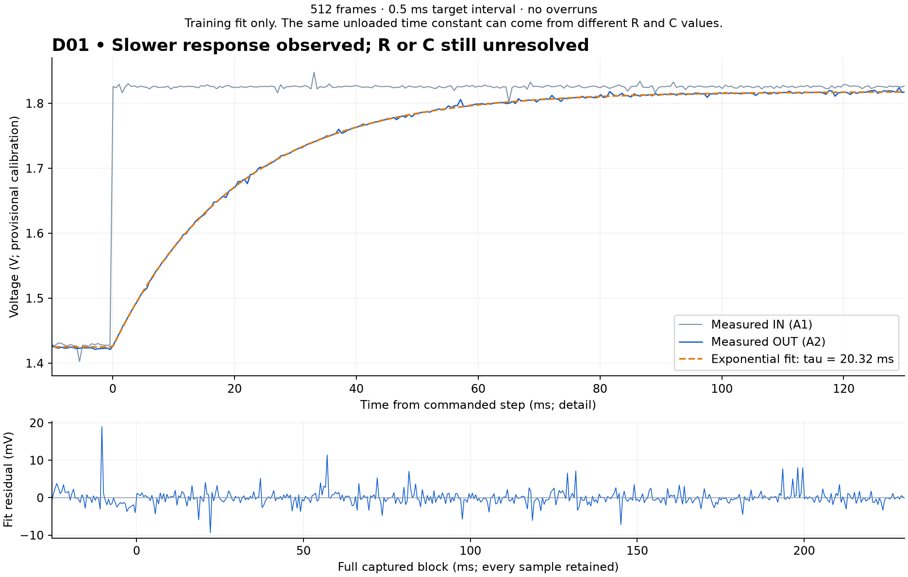

# D01 physical unloaded response — October 29, 2026

The operator confirmed USB-off addition of the parallel capacitor, removal
of the OUT-load jumper, both continuity checks, then fresh supply/REF of
4.88/1.635 V. A fresh Minima boot and REF guard passed. The unloaded step
retained all 512 frames, 497–503 us intervals and zero overruns; the same
boot confirmed REF parking after capture.

The observation-only exponential fit gives **tau = 20.32 ms**, with
**2.00 mV training-fit RMS** (first-50-ms sensitivity tau = 20.30 ms).
**R versus C remains unresolved.** The fitter does not read specimen
component values or assembly instructions. Nominal-design alternatives
with R near 20 kohm or C near 2 uF can have the same unloaded response.
This is a scripted physical engineering observation, not Spark diagnosis,
independent prediction verification or full D2 acceptance.

Two [conditional loaded predictions](load-alternatives/predictions.json)
are saved before any D01 loaded observation. At the illustrative points,
C-change predicts gain 0.49975 / tau 10.156 ms, while R-change predicts
0.32957 / 6.698 ms. The ranges retain declared repair-prior tolerances
conditioned on a point tau; they are not calibrated uncertainty or
posterior probabilities. Full voltage forecasts remain pending fresh
supply/REF and must precede loaded capture.

OUT-load reconnection is requested but not yet confirmed. No physical
D01 repair has occurred. The [guide](../../../docs/d01-assembly.md) fixes
the next order: D01 discrimination and repair check, then restored B1
versus B6 before and after the same measured shunt. The B1/B6 physical
gate is pending; the existing synthetic regression does not satisfy it.

Assembly truth (extra capacitor 0.998 uF; reported total 1.982 uF) is
retained only for setup/evaluation and not used by the tau fit or
conditional loaded predictions. Historical assembly-request and
confirmation snapshots remain unchanged.

[Provenance](provenance.json) lists exact source copies and complete event chains.
