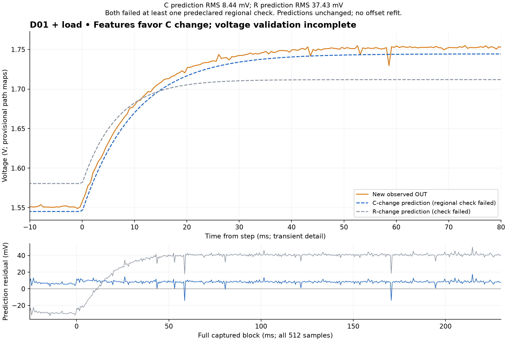
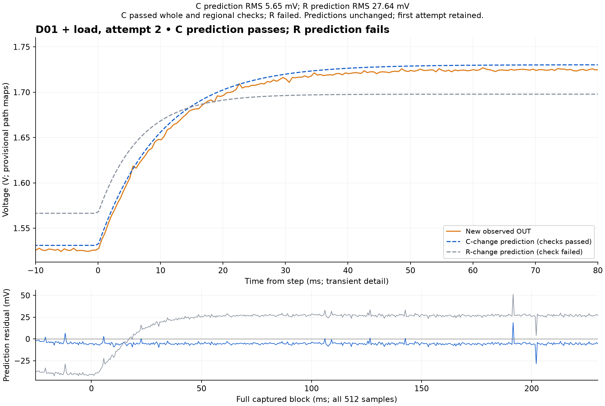

# D01 physical observations — October 29, 2026

The operator confirmed USB-off addition of the parallel capacitor, removal
of the OUT-load jumper, both continuity checks, then fresh supply/REF of
4.88/1.635 V. A fresh Minima boot and REF guard passed. The unloaded step
retained all 512 frames, 497–503 us intervals and zero overruns; the same
boot confirmed REF parking after capture.

The observation-only exponential fit gives **tau = 20.32 ms**, with
**2.00 mV training-fit RMS** (first-50-ms sensitivity tau = 20.30 ms).
**R versus C remains unresolved.** The fitter does not read specimen
component values or assembly instructions. Nominal-design alternatives
with R near 20 kohm or C near 2 uF can have the same unloaded response.
This is a scripted physical engineering observation, not Spark diagnosis,
independent prediction verification or full D2 acceptance.

Two [conditional loaded predictions](load-alternatives/predictions.json)
are saved before any D01 loaded observation. At the illustrative points,
C-change predicts gain 0.49975 / tau 10.156 ms, while R-change predicts
0.32957 / 6.698 ms. The ranges retain declared repair-prior tolerances
conditioned on a point tau; they are not calibrated uncertainty or
posterior probabilities. Both full voltage forecasts were subsequently frozen with fresh
supply/REF (4.89/1.649 V), before even the loaded REF-guard ADC block.

## Loaded attempt 1: neither voltage forecast fully passed

Fresh boot `a09aa39f4755ba059967f31ac9221cd3` remained unchanged. All 512
step frames were retained, with 497–503 us intervals and no overruns;
postcheck confirmed REF code 1381. No parameters, phase or offset were
refit for the frozen prediction score.

| Representative model | Whole RMS | 0–5 ms RMS | 5–20 ms RMS | Result |
|---|---:|---:|---:|---|
| Nominal R, changed C | 8.44 mV | 10.28 mV | 9.33 mV | Failed regional 9 mV limit |
| Changed R, nominal C | 37.43 mV | 22.45 mV | 10.93 mV | Failed whole and regional limits |

A separate descriptive fit gives gain **0.50235**, tau **9.937 ms** and,
conditional on ideal RC and the known intervention load, R **9.896 kohm**,
C **1.999 uF**. Both gain and tau fall inside the previously saved C-change
ranges and outside the R-change ranges. That supports the C-change
explanation under this model, but does **not** change the failed voltage
checks or establish a calibrated confidence interval. No Spark call or
physical repair has occurred.

The C-point residual has mean +8.16 mV. A posthoc mean-centered diagnostic
RMS is 2.14 mV; this is not an allowed offset correction or a rescored pass.
A stationary D50/D45 DMM check is requested to investigate REF/path
mismatch, without changing the output. The report and repeat are recorded below.

## Loaded attempt 2: new forecast, C-point passes

The operator next reported D50/D45/C9 = 1.635/1.645/1.635 V and requested
a repeat. The earlier 1.649 V report is preserved without declaring it an
established misread. At fixed IN, lowering REF by 14 mV would lower a
half-gain prediction by 7 mV, so it does not by itself explain away the
first positive residual.

Both new forecasts were saved before recapture. Supply 4.89 V was retained
from the last report, not remeasured. The original armed boot and code
1381 were confirmed before explicitly moving to code 1369. Calibration,
model parameters, thresholds, and physical wiring stayed unchanged.

| Representative model | Whole RMS | Largest regional RMS | Result |
|---|---:|---:|---|
| Nominal R, changed C | 5.65 mV | 6.03 mV | Passed all declared checks |
| Changed R, nominal C | 27.64 mV | 39.33 mV | Failed |

The separate repeat fit gives gain 0.49579, tau 10.239 ms and conditional
R 10.159 kohm / C 2.033 uF. Both feature estimates again fall within the
predeclared C-change ranges and outside the R-change ranges. This is a
**second development attempt**, not a first-attempt success, untouched
holdout, full-family posterior, or calibrated hardware-accuracy claim.
No physical repair has occurred.

All 512 samples are retained, including the largest C-prediction residual
of 28.39 mV. Frame intervals were 497–503 us, with no overruns; postcheck
retained the same boot and REF code 1369.

## A4 control proposal

The [offline audit](reference-tracking-review/review.json) finds raw A4
estimates 18.4–28.1 mV above their associated DMM reports across four
records. Readings were sequential, so this is not a pure ADC offset test.
Naive A4-to-DAC conversion would change the center by 15–23 codes.
The second attempt A4 guard instead reads 1.63816 V, close to the new
DMM report 1.635 V; a later unchanged-output snapshot gives 1.63814 V.
These changes reinforce the need to separate real REF movement from
ADC/path error. Calibrated reference tracking could reduce meter work;
it is not enabled. A REF/DRIVE/OUT/REF meter report is currently pending
between fixed-output ADC snapshots.
See the [implementation conditions](../../../docs/reference-tracking.md).

The [assembly guide](../../../docs/d01-assembly.md) retains the planned
sequence: D01 validation/repair, restored B1 versus B6, then the same
measured shunt for both. The B1/B6 physical gate remains pending.

Assembly truth (extra capacitor 0.998 uF; reported total 1.982 uF) is
retained only for setup/evaluation and not used by the tau fit or
conditional loaded predictions. Historical assembly-request and
confirmation snapshots remain unchanged.

[Provenance](provenance.json) lists exact source copies and complete event chains.
