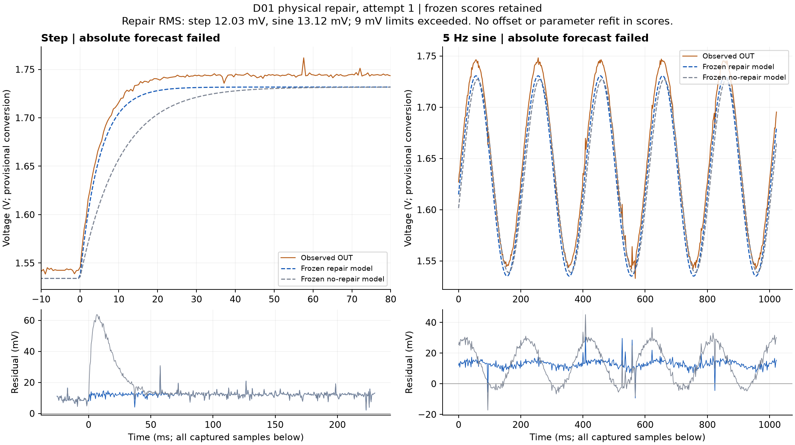

# D01 physical repair — pre-intervention prediction

Status: the operator removed the added capacitor, and the first post-repair
step/sine captures completed. **Both frozen absolute-voltage checks failed**;
the separate fitted dynamics are close to the repair prediction.

Using the earlier loaded-response estimate R = 10.15948 kohm and the
declared nominal repair capacitance 1 uF, with the same 9.99 kohm output load,
the predicted gain stays **0.49579** while loaded tau changes from
**10.239 ms to 5.037 ms**. Measured specimen
component values are not used. This is conditional on the one-state RC model
and provisional calibration, not a calibrated uncertainty statement.

The [frozen plan](model-freeze/20261029T151250-08a588f6dc/plan.json)
contains both repaired and unchanged counterfactual response curves, settings,
whole/regional limits, and the exact operator intervention. Both full voltage
waveforms will be saved after fresh supply/REF readings and before either
post-repair acquisition. The model is already fixed; fresh power readings
configure the stimulus and conversion, never the circuit parameters.

First check: +/-0.2 V step, 512 frames at 500 us. Second check: 5 Hz sine,
+/-0.2 V, 512 frames at 2000 us after the existing warmup. No post-repair
fit, offset adjustment or phase alignment enters the frozen scores. Original
failures remain visible and automatic reference tracking remains disabled.

Plan SHA-256: `f7adca32ddd08ace55dae31f4c5ce112664240e30d560f58ed2f87f08fa9358d`.

## First physical repair attempt

The operator confirmed USB off, extra C removed and original C/wiring retained,
then fresh supply / REF = **4.89 / 1.637 V**. Both voltage waveforms were frozen
before any new ADC. Fresh boot `965280fa5627e569080ee7e6fb95d326` remained
unchanged, and output parked at code **1371**. All five 512-frame captures
were retained: 1,024 verification frames and 1,536 REF-guard frames, with zero
overruns. The A4 block-mean span was 2.401 mV under the nominal conversion.

| Frozen model | Step RMS | 5 Hz sine RMS | Result |
|---|---:|---:|---|
| Repair to nominal C | 12.026 mV | 13.115 mV | Failed the 9 mV whole/regional criteria |
| No-repair counterfactual | 19.419 mV | 17.692 mV | Failed |

No validation sample changed an offset, phase, gain or circuit parameter.
There was no automatic retry. This attempt does not establish verified
absolute-voltage prediction, full D2 acceptance or Spark hardware diagnosis.

The separate descriptive fit gives **tau 4.969 ms**, gain **0.50326**, and
RC-conditional R **9.860 kohm**, C **1.001 uF**. The first-50-ms fit gives
tau 4.948 ms. These dynamics are close to the prior repair forecast of
5.037 ms and differ from the pre-repair 10.239 ms, but this fit does not turn
the failed frozen checks into a pass.

Repair-model mean residuals were +11.856 mV (step) and +12.789 mV (sine).
Mean-centered RMS values of 2.017 and 2.905 mV are diagnostic only; no such
offset correction is permitted in the original scores. Physical REF movement,
path error and conversion error have not been distinguished. The current
request is a stationary D50 REF reading and direct D45-minus-D50 reading,
with output/USB/wiring unchanged.

[Voltage predictions](attempt1-voltage-predictions/prediction.json),
[capture result](attempt1-capture/result.json),
[descriptive analysis](attempt1-analysis/analysis.json), and
[source-copy hashes](attempt1-provenance.json) preserve the full attempt.
