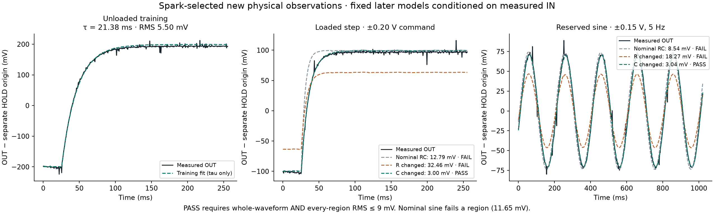

# First Spark-directed physical RC development run

Terminal status: **run_completed**. Actual API responses: **5**. Completed new physical waveform observations: **3**.

The prelaunch automatic approval rejection made no API or serial call. The user then explicitly authorized the destination, measurement-summary payload and at most eight paid requests. That approval and the operator-only assembly record are retained separately from model inputs.

Spark chose each action before the corresponding new physical capture. The load intervention paused for an explicit USB-off wiring/reconnection reply; wiring was performed by the user. The record contains the real tool call IDs, raw ADC blocks, boot checks and all guard observations.

The first unloaded trace fitted only tau: **21.384 ms**, training RMS **5.503 mV**. This does not identify R and C separately. Nominal design alternatives were then frozen without any loaded or reserved OUT data.

| Phase | Model | Whole RMS | Worst region | Passed |
|---|---|---:|---:|---|
| attach_output_load_step | nominal_rc | 12.791 mV | 43.835 mV | False |
| attach_output_load_step | r_changed | 32.457 mV | 38.050 mV | False |
| attach_output_load_step | c_changed | 2.998 mV | 4.117 mV | True |
| reserved_sine | nominal_rc | 8.539 mV | 11.648 mV | False |
| reserved_sine | r_changed | 18.269 mV | 25.120 mV | False |
| reserved_sine | c_changed | 3.043 mV | 4.283 mV | True |

Structured report: **verified / c_changed**.

무부하 스텝 tau 0.0214초로 공칭 0.01초 대비 증가 확인. 9.99kohm 부하 스텝에서 C변경·R공칭 모델만 전체 3.0mV 및 모든 구간 9mV 허용 이내로 지지, 동일 고정 모델의 0.15V 5Hz 사인 검증도 C변경만 전체 3.0mV 전구간 통과. 제한된 물리적 RC/증분/잠정 범위에서 지지됨. 절대 교정 아님.

개체 식별·조립 진실·R/C 연속 정밀값 미확정, 9mV 허용은 교정된 신뢰구간 아님, 수리·신뢰성·완전 진단 미해결.

다른 부하·주파수 조건에서 증분 응답을 추가 측정하여 잠정 모델 유지 여부 확인 필요.

This is a known-passive development experiment using provisional channel maps and measured-IN conditional incremental predictions. A separate HOLD origin precedes every waveform. The 9 mV whole/region allowance is an engineering threshold, not calibrated confidence. No absolute-voltage accuracy, blinded success rate, full D2 acceptance or physical repair is claimed.

[Raw execution](execution/events.jsonl), [audit](audit.json), [source-copy hashes](provenance.json).

The nominal model's sine whole-trace RMS is below 9 mV, but its worst phase
region is 11.648 mV and therefore fails the predeclared joint criterion.
The C-change model's worst loaded-step/sine regions are 4.117/4.283 mV.
No samples or transient spikes were removed. The training fit in the figure
is reconstructed for display from recorded tau; later curves are the original
stored predictions. See [plot provenance](execution/plot-provenance.json).

The run retained **7,680 frames** in 15 capture blocks: three scored/training
waveforms (1,536 frames) and twelve stationary origin/guard blocks (6,144 frames).
There were five actual API requests; the local $5 reservation is not a billing
statement. The load intervention changed the boot with explicit user confirmation;
the reserved sine retained that loaded boot. All raw guards passed, with maximum
recorded A4 block-mean span 0.830 mV. No automatic retry or re-arm occurred.

Latest physical state: added D01 capacitor and OUT E30-A55 load remain installed;
IN A55-C35 branch absent; 996 ohm shunt removed; jumper 11 B28-B35 and jumper 14
retained. Final boot `4faed097aeda0ad9efdd84b22dd1ba4e` confirmed REF park at
code 1371. The earlier physical repair check is a separate milestone; this
run reintroduced the controlled fault for Spark diagnosis and did not repair it.
