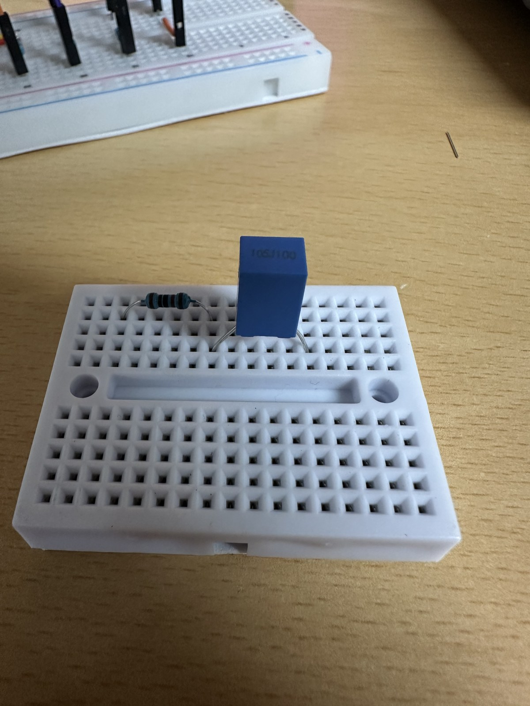
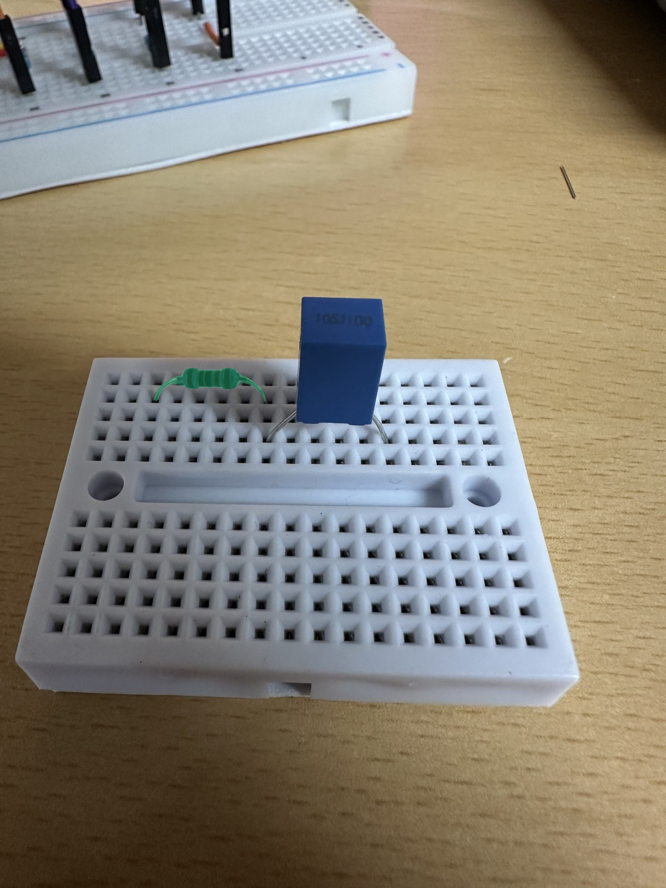

# One real breadboard photo: Spark vision + SAM — November 1

**Mixed result: Spark preserved uncertainty, SAM found the resistor, and SAM missed the capacitor.**
Three requested calls completed, with no retries and no hardware IO. The selected
photo and request plan were published in [64ea504](https://github.com/bami-codes/BenchMate/commit/64ea5046ce4f2c5f5654840f072dd30d111d9a57)
before any response. No extra prompt, crop or box request was used to rescue a miss.

| Task | Observed result | End-to-end request time |
| --- | --- | ---: |
| Spark max, assembly photo | R value unknown; C marked `105J100`, provisional 1 µF; all terminals UNKNOWN; status `incomplete` | 17.70 s |
| SAM `capacitor` | **0 matches** despite the visible blue capacitor; response completed normally | 2.32 s |
| SAM `resistor` | **1 match** following the resistor body and visible leads | 3.35 s |

The photograph was selected by the user, not a random or blind image. It shows an
ordinary one-resistor / one-capacitor mini-board, not the two-capacitor D01 fault.
The user described the resistor as 10 kΩ; this value was **not sent to Spark** and
was **not recovered from the image**. This result does not verify that value.

## Original photo and unedited model mask





Green is only a display overlay of the exact returned binary mask. The decoded
box is `[277, 663, 478, 724)` on the 1200 × 1600 input (right/bottom excluded);
the mask is 201 × 61 pixels, placed without resizing. The response confidence is
0.5631399154663086; this is not a probability that a component value, connection
or diagnosis is correct. A manual visual check found the body and both curved
leads covered, with no obvious extra region; edge accuracy is not scored.

[Binary resistor mask](render-v2/resistor-object-0-mask.png) ·
[All decoded resistor records](render-v2/resistor-decoded.json) ·
[Capacitor zero-match record](render-v2/capacitor-decoded.json).
The capacitor result has no fabricated outline; its all-mask image is the
unchanged input. No returned match was removed or hand-corrected.

## What Spark did and did not establish

Spark returned one provisional resistor and one provisional capacitor. It left
the resistor value null because the bands were unreadable, read `105J100` as a
provisional 1 µF capacitor, and explicitly requested confirmation of the blurry
marking. It left every terminal UNKNOWN because no IN/OUT/REF labels or hidden
breadboard connections were visible. It established no nominal design, verified
netlist, electrical measurement or diagnosis.

Its location boxes remain imprecise: the resistor box's vertical interval is
716.8–796.8 px, below the visible body around 663–702 px. The capacitor box starts
at 576 px and omits the top near 535 px. This is a post-hoc visual inspection,
not a pixel-ground-truth benchmark. Do not use these boxes to target a repair.

## Every response

- [Spark original visible response](vision/20261101T001812-d60c32b5c5/response-visible.json),
  [literal tool arguments](vision/20261101T001812-d60c32b5c5/arguments.txt),
  [validated candidate](vision/20261101T001812-d60c32b5c5/result.json).
- [SAM capacitor response](sam/20261101T001830-76ecaa2b9a/response-visible.json),
  [empty output text](sam/20261101T001830-76ecaa2b9a/output-text.txt).
- [SAM resistor response](sam/20261101T001832-47152bddaa/response-visible.json),
  [original mask text](sam/20261101T001832-47152bddaa/output-text.txt).
- [Structured summary](summary.json), [three-call plan](plan.json),
  [full batch log](events.jsonl), [file manifest](manifest.json).

Spark reported 3,495 input + 2,078 output tokens. Each SAM response reported one
image processed and zero text tokens; **zero tokens does not mean free**. Three
$1 local allowances were reserved; these are not actual invoice amounts.

## Decision for the demo

Do not add a mandatory text-prompt capacitor highlight to the repair flow on
this evidence. The resistor mask is a useful single-image display example.
Neither result validates identification of the extra D01 capacitor. Physical B5
remains the next priority. A future reviewed point/box prompt would be a different
experiment, not a corrected version of this failed capacitor request.

## Privacy, provenance and reproduction

Original phone photos were never read by this runner, sent or committed. The
selected already-clean JPEG was rebuilt as a metadata-free PNG. The other five
cleaned photos remain local; both photo folders are ignored by Git. The API
received only that PNG plus the respective reading instruction or noun phrase,
not filenames, GPS/EXIF, nominal values, assembly truth, ADC or previous results.

The archive copies all original run files byte-for-byte, including the first
offline rendering error. That error was an incorrect parser-factory invocation,
fixed without another API call. The original frozen execution source is under
`source/`; the corrected offline renderer is under `render-v2/source/`. The raw
model output was not changed. The hash audit verified four event chains, three
unique response IDs, original payload/image hashes, source snapshots and the
one decoded mask. Hashes are local integrity checks, not external attestation.

Rendering requires only the optional official parser, not a GPU or a Meta key:

```sh
uv run --extra vision --with meta-sam-parser==0.1.0 python scripts/photo_model_probe.py render --run examples/photo-model-probe/2026-11-01/20261101T001812-2e9c1094fe --output runs/photo-probe-render-check
```

Use a new output directory. This command never makes a paid request. Meta's
[request documentation](https://dev.meta.ai/docs/sam/segmenting),
[wire grammar](https://dev.meta.ai/docs/sam/reading-segmentation) and
[parser documentation](https://dev.meta.ai/docs/sam/client-libraries) were checked.
